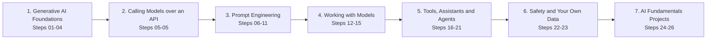
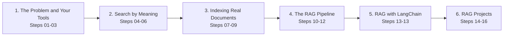
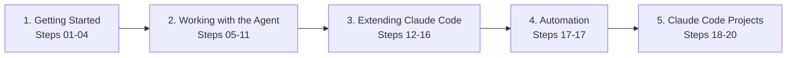

<div align="center">

# 🤖 AI Engineer

### Work with real LLM APIs from a live machine — raw HTTP, official SDKs, embeddings, RAG pipelines, customer deployments, agent harnesses and Claude Code, graded when you press Submit.

**5 skills live · 147 topics · 223 hands-on tasks · 171 quizzes · ~92 hours**

[](https://hemanth9336.github.io/AI-Engineer/)


</div>

## 🚀 How it works

1. **Open the [interactive website](https://hemanth9336.github.io/AI-Engineer/)** - progress is saved in your browser, quizzes are graded instantly.
2. **Set up a practice machine** with [`setup/`](setup/README.md) - one Ubuntu VM plus the lab's AI gateway, connected to a model provider you choose.
3. **Go in order.** Read each lesson, do every task, then run its **Check your work** script - every line should show ✅ before you mark it complete.
4. **Finish with the projects** - small, real AI tools that combine the whole skill.

| Icon | Item | What you do |
|---|---|---|
| 📘 | Lesson | Learn one idea with real prompts, requests, and code |
| 🛠️ | Task | Do it against a real model on your machine, then verify with the checker script |
| ❓ | Quiz | Quick multiple-choice check with explanations |
| 🎭 | Scenario | A realistic on-the-job AI decision to reason through |
| 🏆 | Challenge | A bigger graded job with only the goal given - no step-by-step |

## 🧭 Skills

| Skill | Topics | Tasks | Quizzes | Time | Status |
|---|---|---|---|---|---|
| 🧠 [AI Fundamentals](ai-fundamentals/README.md) | 26 | 27 | 25 | ~955 min | ✅ Live |
| 🔎 [RAG](rag/README.md) | 16 | 22 | 14 | ~765 min | ✅ Live |
| 🚀 [AI Forward Deployed Engineer](fde/README.md) | 44 | 86 | 67 | ~1735 min | ✅ Live |
| 🛠️ [Harness Engineering](harness/README.md) | 41 | 65 | 49 | ~1505 min | ✅ Live |
| ⌨️ [Claude Code Fundamentals](claude-code/README.md) | 20 | 23 | 16 | ~535 min | ✅ Live |

## 🧠 AI Fundamentals

Learn how to actually use Gen AI to get work done in 2026 - prompting that works, choosing models, tools and agents, coding assistants, MCP, and working with your own data - all hands-on against real models through the lab's AI gateway.



### Phase 1 · Generative AI Foundations

_What generative AI is, the tools you will meet, what they are good for, and how models behave._

| Step | Topic | Time | 🛠️ Tasks | ❓ Quizzes |
|---|---|---|---|---|
| 01 | [What is Generative AI](ai-fundamentals/01-what-is-generative-ai/) | ~20m | 0 | 1 |
| 02 | [The AI tool landscape](ai-fundamentals/02-the-ai-tool-landscape/) | ~20m | 0 | 1 |
| 03 | [What you can do with AI](ai-fundamentals/03-what-you-can-do-with-ai/) | ~20m | 0 | 1 |
| 04 | [AI absolute basics](ai-fundamentals/04-ai-absolute-basics/) | ~45m | 1 | 1 |

### Phase 2 · Calling Models over an API

_Send your own requests to real models with curl and read every part of the reply._

| Step | Topic | Time | 🛠️ Tasks | ❓ Quizzes |
|---|---|---|---|---|
| 05 | [Calling LLMs over an API](ai-fundamentals/05-calling-llms-over-an-api/) | ~40m | 4 | 1 |

### Phase 3 · Prompt Engineering

_Clear prompts, examples, step-by-step reasoning, roles, output control, and the refine loop._

| Step | Topic | Time | 🛠️ Tasks | ❓ Quizzes |
|---|---|---|---|---|
| 06 | [Writing prompts that work](ai-fundamentals/06-writing-prompts-that-work/) | ~35m | 1 | 1 |
| 07 | [Prompting with examples](ai-fundamentals/07-prompting-with-examples/) | ~35m | 1 | 1 |
| 08 | [Step-by-step prompting](ai-fundamentals/08-step-by-step-prompting/) | ~35m | 1 | 1 |
| 09 | [AI roles and personas](ai-fundamentals/09-ai-roles-and-personas/) | ~30m | 1 | 1 |
| 10 | [Controlling the output](ai-fundamentals/10-controlling-the-output/) | ~35m | 1 | 1 |
| 11 | [Improving your prompts](ai-fundamentals/11-improving-your-prompts/) | ~35m | 1 | 1 |

### Phase 4 · Working with Models

_Conversations and the context window, choosing a model, tokens and cost, and JSON output._

| Step | Topic | Time | 🛠️ Tasks | ❓ Quizzes |
|---|---|---|---|---|
| 12 | [Multi-turn conversations](ai-fundamentals/12-multi-turn-conversations/) | ~35m | 1 | 1 |
| 13 | [Choosing a model](ai-fundamentals/13-choosing-a-model/) | ~35m | 1 | 1 |
| 14 | [Tokens and cost](ai-fundamentals/14-tokens-and-cost/) | ~35m | 1 | 1 |
| 15 | [Structured output with JSON](ai-fundamentals/15-structured-output-with-json/) | ~35m | 1 | 1 |

### Phase 5 · Tools, Assistants and Agents

_Tool calling, coding assistants, MCP, the official SDKs, LangChain, and agents._

| Step | Topic | Time | 🛠️ Tasks | ❓ Quizzes |
|---|---|---|---|---|
| 16 | [Tool Calling](ai-fundamentals/16-tool-calling/) | ~35m | 1 | 1 |
| 17 | [AI Coding Assistants](ai-fundamentals/17-ai-coding-assistants/) | ~35m | 1 | 1 |
| 18 | [Model Context Protocol](ai-fundamentals/18-model-context-protocol/) | ~35m | 1 | 1 |
| 19 | [Using the API in real code](ai-fundamentals/19-using-the-api-in-real-code/) | ~45m | 3 | 2 |
| 20 | [LangChain basics](ai-fundamentals/20-langchain-basics/) | ~35m | 1 | 1 |
| 21 | [Building Agents](ai-fundamentals/21-building-agents/) | ~35m | 1 | 1 |

### Phase 6 · Safety and Your Own Data

_Hallucinations, prompt injection, privacy, and grounding answers in your own documents._

| Step | Topic | Time | 🛠️ Tasks | ❓ Quizzes |
|---|---|---|---|---|
| 22 | [Limitations and safety](ai-fundamentals/22-limitations-and-safety/) | ~30m | 0 | 2 |
| 23 | [Using your own data](ai-fundamentals/23-using-your-own-data/) | ~35m | 1 | 1 |

### Phase 7 · AI Fundamentals Projects

_Three small, real tools that put the whole skill to work._

| Step | Topic | Time | 🛠️ Tasks | ❓ Quizzes |
|---|---|---|---|---|
| 24 | [Project: support ticket triage tool](ai-fundamentals/24-project-support-ticket-triage-tool/) | ~60m | 1 | 0 |
| 25 | [Project: log explainer CLI](ai-fundamentals/25-project-log-explainer-cli/) | ~60m | 1 | 0 |
| 26 | [Project: grounded runbook assistant](ai-fundamentals/26-project-grounded-runbook-assistant/) | ~60m | 1 | 0 |

## 🔎 RAG

Build Retrieval-Augmented Generation from nothing - ground a model in your own documents, create embeddings, search by meaning, chunk real files, run a vector database, and ship a working RAG pipeline by hand, on Chroma, and with LangChain.



### Phase 1 · The Problem and Your Tools

_Why models can't answer about your data, the Python you need, and grounding a prompt._

| Step | Topic | Time | 🛠️ Tasks | ❓ Quizzes |
|---|---|---|---|---|
| 01 | [The Problem RAG Solves](rag/01-the-problem-rag-solves/) | ~40m | 1 | 1 |
| 02 | [Tools You Will Use](rag/02-tools-you-will-use/) | ~35m | 1 | 1 |
| 03 | [Grounding a Prompt](rag/03-grounding-a-prompt/) | ~40m | 1 | 1 |

### Phase 2 · Search by Meaning

_Embeddings, cosine similarity, and semantic search - the retrieval half of RAG._

| Step | Topic | Time | 🛠️ Tasks | ❓ Quizzes |
|---|---|---|---|---|
| 04 | [Embeddings](rag/04-embeddings/) | ~40m | 1 | 1 |
| 05 | [Measuring Similarity](rag/05-measuring-similarity/) | ~40m | 1 | 1 |
| 06 | [Semantic Search](rag/06-semantic-search/) | ~35m | 1 | 1 |

### Phase 3 · Indexing Real Documents

_Chunking files, a vector store built by hand, and Chroma._

| Step | Topic | Time | 🛠️ Tasks | ❓ Quizzes |
|---|---|---|---|---|
| 07 | [Chunking](rag/07-chunking/) | ~50m | 2 | 1 |
| 08 | [Build Your Own Vector Store](rag/08-build-your-own-vector-store/) | ~50m | 2 | 1 |
| 09 | [Chroma, a Real Vector Database](rag/09-chroma-a-real-vector-database/) | ~50m | 2 | 1 |

### Phase 4 · The RAG Pipeline

_Every piece connected, moved onto Chroma, and measured._

| Step | Topic | Time | 🛠️ Tasks | ❓ Quizzes |
|---|---|---|---|---|
| 10 | [The Full RAG Pipeline](rag/10-the-full-rag-pipeline/) | ~50m | 1 | 2 |
| 11 | [RAG on Chroma](rag/11-rag-on-chroma/) | ~45m | 1 | 1 |
| 12 | [Evaluating RAG](rag/12-evaluating-rag/) | ~50m | 2 | 1 |

### Phase 5 · RAG with LangChain

_The same pipeline with the library teams use at work._

| Step | Topic | Time | 🛠️ Tasks | ❓ Quizzes |
|---|---|---|---|---|
| 13 | [RAG with LangChain](rag/13-rag-with-langchain/) | ~60m | 3 | 1 |

### Phase 6 · RAG Projects

_Three complete assistants that answer from documents - and refuse when they can't._

| Step | Topic | Time | 🛠️ Tasks | ❓ Quizzes |
|---|---|---|---|---|
| 14 | [Project: Docs Q&A Bot](rag/14-project-docs-qa-bot/) | ~60m | 1 | 0 |
| 15 | [Project: Support Knowledge Assistant](rag/15-project-support-knowledge-assistant/) | ~60m | 1 | 0 |
| 16 | [Project: Runbook Assistant That Knows Its Limits](rag/16-project-runbook-assistant-that-knows-its-limits/) | ~60m | 1 | 0 |

## 🚀 AI Forward Deployed Engineer

Become the engineer who ships AI inside real companies - from zero. Learn how LLMs work, build RAG and tool-calling assistants over messy customer data, prove quality with evals, harden for cost and safety, and run a full customer engagement from discovery to handoff.

```mermaid
flowchart LR
  P0["1. The FDE Role<br/>Steps 01-02"]
  P1["2. How LLMs Work<br/>Steps 03-04"]
  P2["3. Building Blocks<br/>Steps 05-07"]
  P3["4. Prompting<br/>Steps 08-10"]
  P4["5. Tools and Conversation State<br/>Steps 11-12"]
  P5["6. Retrieval over Customer Data<br/>Steps 13-19"]
  P6["7. Agents and Integrations<br/>Steps 20-24"]
  P7["8. Proving It Works<br/>Steps 25-30"]
  P8["9. Hardening for Production<br/>Steps 31-36"]
  P9["10. Running the Engagement<br/>Steps 37-41"]
  P10["11. Capstone Projects<br/>Steps 42-44"]
  P0 --> P1 --> P2 --> P3 --> P4 --> P5 --> P6 --> P7 --> P8 --> P9 --> P10
```



### Phase 1 · The FDE Role

_What a forward deployed engineer does, and the shape of a customer engagement._

| Step | Topic | Time | 🛠️ Tasks | ❓ Quizzes |
|---|---|---|---|---|
| 01 | [What an FDE does](fde/01-what-an-fde-does/) | ~30m | 0 | 3 |
| 02 | [The engagement lifecycle](fde/02-the-engagement-lifecycle/) | ~30m | 0 | 3 |

### Phase 2 · How LLMs Work

_Next-token prediction, hallucinations, tokens, context windows, and cost._

| Step | Topic | Time | 🛠️ Tasks | ❓ Quizzes |
|---|---|---|---|---|
| 03 | [How LLMs work](fde/03-how-llms-work/) | ~35m | 2 | 1 |
| 04 | [Tokens, context, and cost](fde/04-tokens-context-and-cost/) | ~40m | 3 | 1 |

### Phase 3 · Building Blocks

_Just enough Python, calling models over an API, and choosing the right model._

| Step | Topic | Time | 🛠️ Tasks | ❓ Quizzes |
|---|---|---|---|---|
| 05 | [Just enough Python](fde/05-just-enough-python/) | ~40m | 3 | 1 |
| 06 | [Calling LLMs over an API](fde/06-calling-llms-over-an-api/) | ~40m | 3 | 1 |
| 07 | [Choosing a model](fde/07-choosing-a-model/) | ~35m | 2 | 2 |

### Phase 4 · Prompting

_Clear prompts, prompts as a product surface, and output a program can trust._

| Step | Topic | Time | 🛠️ Tasks | ❓ Quizzes |
|---|---|---|---|---|
| 08 | [Prompt engineering basics](fde/08-prompt-engineering-basics/) | ~40m | 3 | 1 |
| 09 | [Prompts in production](fde/09-prompts-in-production/) | ~40m | 2 | 2 |
| 10 | [Structured output](fde/10-structured-output/) | ~40m | 3 | 1 |

### Phase 5 · Tools and Conversation State

_Letting the model call your code, and keeping track of a conversation._

| Step | Topic | Time | 🛠️ Tasks | ❓ Quizzes |
|---|---|---|---|---|
| 11 | [Tool calling](fde/11-tool-calling/) | ~40m | 3 | 1 |
| 12 | [Conversation state](fde/12-conversation-state/) | ~40m | 3 | 1 |

### Phase 6 · Retrieval over Customer Data

_Embeddings, vector search, RAG, messy documents, citations, and permissions._

| Step | Topic | Time | 🛠️ Tasks | ❓ Quizzes |
|---|---|---|---|---|
| 13 | [Embeddings](fde/13-embeddings/) | ~30m | 2 | 1 |
| 14 | [Vector search](fde/14-vector-search/) | ~35m | 2 | 1 |
| 15 | [The RAG pipeline](fde/15-the-rag-pipeline/) | ~35m | 2 | 1 |
| 16 | [Chunking enterprise documents](fde/16-chunking-enterprise-documents/) | ~45m | 3 | 1 |
| 17 | [Retrieval quality](fde/17-retrieval-quality/) | ~45m | 3 | 1 |
| 18 | [Citations and grounding](fde/18-citations-and-grounding/) | ~35m | 2 | 2 |
| 19 | [Permissions-aware retrieval](fde/19-permissions-aware-retrieval/) | ~35m | 2 | 2 |

### Phase 7 · Agents and Integrations

_Agents, MCP, customer APIs, and getting data out of customer systems._

| Step | Topic | Time | 🛠️ Tasks | ❓ Quizzes |
|---|---|---|---|---|
| 20 | [Agents](fde/20-agents/) | ~30m | 1 | 2 |
| 21 | [Multi-step agents](fde/21-multi-step-agents/) | ~40m | 3 | 1 |
| 22 | [MCP](fde/22-mcp/) | ~40m | 2 | 1 |
| 23 | [Connecting to customer APIs](fde/23-connecting-to-customer-apis/) | ~35m | 2 | 2 |
| 24 | [Getting data out of customer systems](fde/24-getting-data-out-of-customer-systems/) | ~40m | 3 | 1 |

### Phase 8 · Proving It Works

_Evals, golden datasets, LLM judges, regression gates, RAG metrics, and the fine-tuning question._

| Step | Topic | Time | 🛠️ Tasks | ❓ Quizzes |
|---|---|---|---|---|
| 25 | [Why evals](fde/25-why-evals/) | ~25m | 0 | 3 |
| 26 | [Golden datasets](fde/26-golden-datasets/) | ~40m | 3 | 1 |
| 27 | [LLM as judge](fde/27-llm-as-judge/) | ~35m | 2 | 1 |
| 28 | [Prompt regression testing](fde/28-prompt-regression-testing/) | ~35m | 2 | 1 |
| 29 | [Measuring RAG quality](fde/29-measuring-rag-quality/) | ~40m | 2 | 2 |
| 30 | [The fine-tuning decision](fde/30-the-fine-tuning-decision/) | ~30m | 0 | 3 |

### Phase 9 · Hardening for Production

_Guardrails, abstaining, cost, latency, observability, security, and PII._

| Step | Topic | Time | 🛠️ Tasks | ❓ Quizzes |
|---|---|---|---|---|
| 31 | [Guardrails](fde/31-guardrails/) | ~45m | 3 | 1 |
| 32 | [Reducing hallucinations](fde/32-reducing-hallucinations/) | ~30m | 2 | 1 |
| 33 | [Cost control](fde/33-cost-control/) | ~40m | 3 | 1 |
| 34 | [Latency and streaming](fde/34-latency-and-streaming/) | ~30m | 2 | 1 |
| 35 | [Observability](fde/35-observability/) | ~40m | 3 | 1 |
| 36 | [Security, PII, and deployment](fde/36-security-pii-and-deployment/) | ~45m | 2 | 3 |

### Phase 10 · Running the Engagement

_Discovery, prototypes, demos, pilots, and a handoff that survives without you._

| Step | Topic | Time | 🛠️ Tasks | ❓ Quizzes |
|---|---|---|---|---|
| 37 | [Discovery and scoping](fde/37-discovery-and-scoping/) | ~35m | 1 | 3 |
| 38 | [Rapid prototyping](fde/38-rapid-prototyping/) | ~35m | 1 | 3 |
| 39 | [Demos and expectations](fde/39-demos-and-expectations/) | ~30m | 0 | 3 |
| 40 | [Running a pilot](fde/40-running-a-pilot/) | ~45m | 2 | 3 |
| 41 | [Production rollout and handoff](fde/41-production-rollout-and-handoff/) | ~35m | 1 | 2 |

### Phase 11 · Capstone Projects

_Three end-to-end builds that put the whole role to work._

| Step | Topic | Time | 🛠️ Tasks | ❓ Quizzes |
|---|---|---|---|---|
| 42 | [Project: Internal docs Q&A bot](fde/42-project-internal-docs-qa-bot/) | ~60m | 1 | 0 |
| 43 | [Project: Support assistant with evals](fde/43-project-support-assistant-with-evals/) | ~75m | 1 | 0 |
| 44 | [Project: Full engagement simulation](fde/44-project-full-engagement-simulation/) | ~90m | 1 | 0 |

## 🛠️ Harness Engineering

Build the machinery around AI models - from zero. Learn how LLMs and tool calling work, build agent loops by hand, design tools and context, add permissions and injection defenses, orchestrate subagents, prove behavior with evals, and dissect a production harness.

```mermaid
flowchart LR
  P0["1. Foundations<br/>Steps 01-06"]
  P1["2. The Agent Loop<br/>Steps 07-11"]
  P2["3. Tool Design<br/>Steps 12-15"]
  P3["4. Context Engineering<br/>Steps 16-20"]
  P4["5. Permissions and Safety<br/>Steps 21-24"]
  P5["6. Orchestration<br/>Steps 25-28"]
  P6["7. Evals and Observability<br/>Steps 29-33"]
  P7["8. Production Harnesses<br/>Steps 34-38"]
  P8["9. Capstone Projects<br/>Steps 39-41"]
  P0 --> P1 --> P2 --> P3 --> P4 --> P5 --> P6 --> P7 --> P8
```



### Phase 1 · Foundations

_What a harness is, how LLMs behave, just enough Python, API calls, tokens, and tool calling._

| Step | Topic | Time | 🛠️ Tasks | ❓ Quizzes |
|---|---|---|---|---|
| 01 | [What a harness is](harness/01-what-a-harness-is/) | ~30m | 0 | 2 |
| 02 | [How LLMs work for harness builders](harness/02-how-llms-work-for-harness-builders/) | ~30m | 2 | 1 |
| 03 | [Just enough Python](harness/03-just-enough-python/) | ~40m | 3 | 1 |
| 04 | [Calling LLMs over an API](harness/04-calling-llms-over-an-api/) | ~40m | 3 | 1 |
| 05 | [Tokens, context, and cost](harness/05-tokens-context-and-cost/) | ~40m | 3 | 1 |
| 06 | [Tool calling](harness/06-tool-calling/) | ~40m | 2 | 1 |

### Phase 2 · The Agent Loop

_Build the loop by hand: stop conditions, errors, history, and asking the human._

| Step | Topic | Time | 🛠️ Tasks | ❓ Quizzes |
|---|---|---|---|---|
| 07 | [Your first agent loop](harness/07-your-first-agent-loop/) | ~40m | 2 | 1 |
| 08 | [Stop conditions](harness/08-stop-conditions/) | ~35m | 2 | 2 |
| 09 | [Error handling in the loop](harness/09-error-handling-in-the-loop/) | ~35m | 2 | 1 |
| 10 | [Loop state and history](harness/10-loop-state-and-history/) | ~35m | 2 | 1 |
| 11 | [Making the agent ask for help](harness/11-making-the-agent-ask-for-help/) | ~25m | 1 | 2 |

### Phase 3 · Tool Design

_Tools are prompts: descriptions, result shapes, tool sets, and dangerous actions._

| Step | Topic | Time | 🛠️ Tasks | ❓ Quizzes |
|---|---|---|---|---|
| 12 | [Tools are prompts](harness/12-tools-are-prompts/) | ~35m | 2 | 1 |
| 13 | [Designing tool results](harness/13-designing-tool-results/) | ~35m | 2 | 1 |
| 14 | [Tool sets and selection](harness/14-tool-sets-and-selection/) | ~30m | 1 | 2 |
| 15 | [Dangerous tools](harness/15-dangerous-tools/) | ~30m | 1 | 2 |

### Phase 4 · Context Engineering

_System prompts, budgets, compaction, file memory, and retrieval into context._

| Step | Topic | Time | 🛠️ Tasks | ❓ Quizzes |
|---|---|---|---|---|
| 16 | [The system prompt](harness/16-the-system-prompt/) | ~35m | 2 | 1 |
| 17 | [Context budgeting](harness/17-context-budgeting/) | ~35m | 2 | 1 |
| 18 | [Compaction and summarization](harness/18-compaction-and-summarization/) | ~35m | 2 | 1 |
| 19 | [File-based memory](harness/19-file-based-memory/) | ~35m | 2 | 1 |
| 20 | [Retrieval into context](harness/20-retrieval-into-context/) | ~30m | 1 | 1 |

### Phase 5 · Permissions and Safety

_Permission models, sandboxes, prompt injection through tools, and secrets hygiene._

| Step | Topic | Time | 🛠️ Tasks | ❓ Quizzes |
|---|---|---|---|---|
| 21 | [Permission models](harness/21-permission-models/) | ~35m | 1 | 2 |
| 22 | [Sandboxing](harness/22-sandboxing/) | ~30m | 1 | 1 |
| 23 | [Prompt injection through tools](harness/23-prompt-injection-through-tools/) | ~35m | 2 | 1 |
| 24 | [Secrets hygiene](harness/24-secrets-hygiene/) | ~30m | 2 | 2 |

### Phase 6 · Orchestration

_Subagents, parallel agents, verifiers, and the ways multi-agent systems fail._

| Step | Topic | Time | 🛠️ Tasks | ❓ Quizzes |
|---|---|---|---|---|
| 25 | [Subagents](harness/25-subagents/) | ~30m | 1 | 1 |
| 26 | [Parallel agents](harness/26-parallel-agents/) | ~30m | 1 | 1 |
| 27 | [Verification patterns](harness/27-verification-patterns/) | ~35m | 2 | 1 |
| 28 | [Orchestration failure modes](harness/28-orchestration-failure-modes/) | ~30m | 1 | 2 |

### Phase 7 · Evals and Observability

_Grading trajectories, eval suites, transcripts, cost caps, and regression gates._

| Step | Topic | Time | 🛠️ Tasks | ❓ Quizzes |
|---|---|---|---|---|
| 29 | [Evals for agents](harness/29-evals-for-agents/) | ~25m | 0 | 2 |
| 30 | [Building an agent eval suite](harness/30-building-an-agent-eval-suite/) | ~40m | 2 | 1 |
| 31 | [Transcripts and replay](harness/31-transcripts-and-replay/) | ~35m | 2 | 1 |
| 32 | [Cost and latency of agents](harness/32-cost-and-latency-of-agents/) | ~35m | 2 | 1 |
| 33 | [Regression testing a harness](harness/33-regression-testing-a-harness/) | ~30m | 2 | 1 |

### Phase 8 · Production Harnesses

_Dissect and extend Claude Code: MCP, hooks, instruction files, skills, and choosing your layer._

| Step | Topic | Time | 🛠️ Tasks | ❓ Quizzes |
|---|---|---|---|---|
| 34 | [Claude Code as a harness](harness/34-claude-code-as-a-harness/) | ~35m | 1 | 1 |
| 35 | [Extending a harness with MCP](harness/35-extending-a-harness-with-mcp/) | ~35m | 2 | 1 |
| 36 | [Hooks and instruction files](harness/36-hooks-and-instruction-files/) | ~35m | 2 | 1 |
| 37 | [Packaging behavior as skills](harness/37-packaging-behavior-as-skills/) | ~25m | 1 | 1 |
| 38 | [Choosing your layer](harness/38-choosing-your-layer/) | ~25m | 0 | 3 |

### Phase 9 · Capstone Projects

_Three end-to-end builds: a coding agent, a hardened harness, and a production triage harness._

| Step | Topic | Time | 🛠️ Tasks | ❓ Quizzes |
|---|---|---|---|---|
| 39 | [Project: Build a coding agent](harness/39-project-build-a-coding-agent/) | ~75m | 1 | 0 |
| 40 | [Project: Harden the harness](harness/40-project-harden-the-harness/) | ~75m | 1 | 0 |
| 41 | [Project: Production harness](harness/41-project-production-harness/) | ~90m | 1 | 0 |

## ⌨️ Claude Code Fundamentals

Learn to drive Claude Code as a daily tool - the interactive console, permissions, headless scripting, project memory, plan mode, git work, custom commands, subagents, hooks, MCP, and settings - all hands-on, graded when you press Submit.



### Phase 1 · Getting Started

_Set up, the interactive console, permissions, and headless runs with -p._

| Step | Topic | Time | 🛠️ Tasks | ❓ Quizzes |
|---|---|---|---|---|
| 01 | [Claude Code: Setup & Prerequisites](claude-code/01-setup-and-prerequisites/) | ~20m | 1 | 0 |
| 02 | [Claude Code: Inside the Console](claude-code/02-inside-the-console/) | ~30m | 2 | 1 |
| 03 | [Claude Code: Permissions and Safety](claude-code/03-permissions-and-safety/) | ~25m | 1 | 1 |
| 04 | [Claude Code: Headless with -p](claude-code/04-headless-with-p/) | ~25m | 3 | 1 |

### Phase 2 · Working with the Agent

_Clear instructions, project memory, context, plan mode, whole-codebase work, debugging, and git._

| Step | Topic | Time | 🛠️ Tasks | ❓ Quizzes |
|---|---|---|---|---|
| 05 | [Claude Code: Instructing the Agent](claude-code/05-instructing-the-agent/) | ~25m | 1 | 1 |
| 06 | [Claude Code: Project Memory](claude-code/06-project-memory/) | ~25m | 1 | 1 |
| 07 | [Claude Code: Managing Context](claude-code/07-managing-context/) | ~20m | 1 | 1 |
| 08 | [Claude Code: Plan Mode](claude-code/08-plan-mode/) | ~20m | 1 | 1 |
| 09 | [Claude Code: Working Across a Codebase](claude-code/09-working-across-a-codebase/) | ~25m | 1 | 1 |
| 10 | [Claude Code: Debugging](claude-code/10-debugging/) | ~25m | 1 | 1 |
| 11 | [Claude Code: Git Work](claude-code/11-git-work/) | ~25m | 1 | 1 |

### Phase 3 · Extending Claude Code

_Custom slash commands, subagents, hooks, MCP servers, and settings._

| Step | Topic | Time | 🛠️ Tasks | ❓ Quizzes |
|---|---|---|---|---|
| 12 | [Claude Code: Custom Slash Commands](claude-code/12-custom-slash-commands/) | ~20m | 1 | 1 |
| 13 | [Claude Code: Subagents](claude-code/13-subagents/) | ~20m | 1 | 1 |
| 14 | [Claude Code: Hooks](claude-code/14-hooks/) | ~25m | 1 | 1 |
| 15 | [Claude Code: MCP Servers](claude-code/15-mcp-servers/) | ~25m | 1 | 1 |
| 16 | [Claude Code: Settings](claude-code/16-settings/) | ~20m | 1 | 1 |

### Phase 4 · Automation

_Headless Claude Code in scripts and on a schedule._

| Step | Topic | Time | 🛠️ Tasks | ❓ Quizzes |
|---|---|---|---|---|
| 17 | [Claude Code: Automation](claude-code/17-automation/) | ~25m | 1 | 1 |

### Phase 5 · Claude Code Projects

_Three end-to-end jobs: build a CLI, fix a broken repo, configure a project._

| Step | Topic | Time | 🛠️ Tasks | ❓ Quizzes |
|---|---|---|---|---|
| 18 | [Claude Code Project: Build a CLI Tool](claude-code/18-project-build-a-cli-tool/) | ~45m | 1 | 0 |
| 19 | [Claude Code Project: Fix a Broken Repo](claude-code/19-project-fix-a-broken-repo/) | ~45m | 1 | 0 |
| 20 | [Claude Code Project: Configure a Project](claude-code/20-project-configure-a-project/) | ~45m | 1 | 0 |

## 📁 Repository layout

```text
AI-Engineer/
├── index.html                 # the interactive website (GitHub Pages)
├── assets/                    # site styles and scripts
├── data/ai-engineer.json      # generated index used by the site
├── setup/                     # practice machine and AI gateway setup
├── ai-fundamentals/           # one folder per skill
│   ├── README.md              # skill roadmap
│   ├── 01-what-is-generative-ai/
│   │   ├── README.md          # step overview
│   │   ├── 01-generative-ai-versus-traditional-software.md
│   │   └── ...
│   └── ... one folder per step ...
├── docs/CONTENT_GUIDE.md      # format contract for new content
└── scripts/                   # manifest, scaffold, and build/validation
```

## ➕ Adding the next skill

1. Add the skill (steps and items) to `scripts/manifest.py`.
2. `python3 scripts/scaffold.py` creates every folder and file.
3. Write the content following [`docs/CONTENT_GUIDE.md`](docs/CONTENT_GUIDE.md).
4. `python3 scripts/build_index.py` validates everything and updates the site and READMEs.

## 🛠️ Run the site locally

```bash
python3 scripts/build_index.py
python3 -m http.server 8000   # open http://localhost:8000
```

---

<div align="center">Built by <a href="https://github.com/Hemanth9336">Hemanth</a> · ⭐ Star the repo if it helps you on your AI engineering journey</div>
