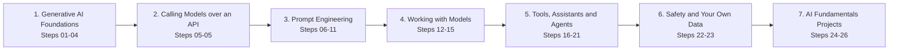
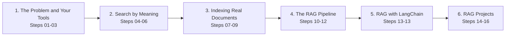

<div align="center">

# 🤖 AI Engineer

### Work with real LLM APIs from a live machine — raw HTTP, official SDKs, embeddings, vector databases and RAG pipelines, graded when you press Submit.

**2 skills live · 42 topics · 49 hands-on tasks · 39 quizzes · ~29 hours**

[](https://hemanth9336.github.io/AI-Engineer/)


</div>

## 🚀 How it works

1. **Open the [interactive website](https://hemanth9336.github.io/AI-Engineer/)** - progress is saved in your browser, quizzes are graded instantly.
2. **Set up a practice machine** with [`setup/`](setup/README.md) - one Ubuntu VM plus the lab's AI gateway, connected to a model provider you choose.
3. **Go in order.** Read each lesson, do every task, then run its **Check your work** script - every line should show ✅ before you mark it complete.
4. **Finish with the projects** - small, real AI tools that combine the whole skill.

| Icon | Item | What you do |
|---|---|---|
| 📘 | Lesson | Learn one idea with real prompts, requests, and code |
| 🛠️ | Task | Do it against a real model on your machine, then verify with the checker script |
| ❓ | Quiz | Quick multiple-choice check with explanations |
| 🎭 | Scenario | A realistic on-the-job AI decision to reason through |
| 🏆 | Challenge | A bigger graded job with only the goal given - no step-by-step |

## 🧭 Skills

| Skill | Topics | Tasks | Quizzes | Time | Status |
|---|---|---|---|---|---|
| 🧠 [AI Fundamentals](ai-fundamentals/README.md) | 26 | 27 | 25 | ~955 min | ✅ Live |
| 🔎 [RAG](rag/README.md) | 16 | 22 | 14 | ~765 min | ✅ Live |

## 🧠 AI Fundamentals

Learn how to actually use Gen AI to get work done in 2026 - prompting that works, choosing models, tools and agents, coding assistants, MCP, and working with your own data - all hands-on against real models through the lab's AI gateway.



### Phase 1 · Generative AI Foundations

_What generative AI is, the tools you will meet, what they are good for, and how models behave._

| Step | Topic | Time | 🛠️ Tasks | ❓ Quizzes |
|---|---|---|---|---|
| 01 | [What is Generative AI](ai-fundamentals/01-what-is-generative-ai/) | ~20m | 0 | 1 |
| 02 | [The AI tool landscape](ai-fundamentals/02-the-ai-tool-landscape/) | ~20m | 0 | 1 |
| 03 | [What you can do with AI](ai-fundamentals/03-what-you-can-do-with-ai/) | ~20m | 0 | 1 |
| 04 | [AI absolute basics](ai-fundamentals/04-ai-absolute-basics/) | ~45m | 1 | 1 |

### Phase 2 · Calling Models over an API

_Send your own requests to real models with curl and read every part of the reply._

| Step | Topic | Time | 🛠️ Tasks | ❓ Quizzes |
|---|---|---|---|---|
| 05 | [Calling LLMs over an API](ai-fundamentals/05-calling-llms-over-an-api/) | ~40m | 4 | 1 |

### Phase 3 · Prompt Engineering

_Clear prompts, examples, step-by-step reasoning, roles, output control, and the refine loop._

| Step | Topic | Time | 🛠️ Tasks | ❓ Quizzes |
|---|---|---|---|---|
| 06 | [Writing prompts that work](ai-fundamentals/06-writing-prompts-that-work/) | ~35m | 1 | 1 |
| 07 | [Prompting with examples](ai-fundamentals/07-prompting-with-examples/) | ~35m | 1 | 1 |
| 08 | [Step-by-step prompting](ai-fundamentals/08-step-by-step-prompting/) | ~35m | 1 | 1 |
| 09 | [AI roles and personas](ai-fundamentals/09-ai-roles-and-personas/) | ~30m | 1 | 1 |
| 10 | [Controlling the output](ai-fundamentals/10-controlling-the-output/) | ~35m | 1 | 1 |
| 11 | [Improving your prompts](ai-fundamentals/11-improving-your-prompts/) | ~35m | 1 | 1 |

### Phase 4 · Working with Models

_Conversations and the context window, choosing a model, tokens and cost, and JSON output._

| Step | Topic | Time | 🛠️ Tasks | ❓ Quizzes |
|---|---|---|---|---|
| 12 | [Multi-turn conversations](ai-fundamentals/12-multi-turn-conversations/) | ~35m | 1 | 1 |
| 13 | [Choosing a model](ai-fundamentals/13-choosing-a-model/) | ~35m | 1 | 1 |
| 14 | [Tokens and cost](ai-fundamentals/14-tokens-and-cost/) | ~35m | 1 | 1 |
| 15 | [Structured output with JSON](ai-fundamentals/15-structured-output-with-json/) | ~35m | 1 | 1 |

### Phase 5 · Tools, Assistants and Agents

_Tool calling, coding assistants, MCP, the official SDKs, LangChain, and agents._

| Step | Topic | Time | 🛠️ Tasks | ❓ Quizzes |
|---|---|---|---|---|
| 16 | [Tool Calling](ai-fundamentals/16-tool-calling/) | ~35m | 1 | 1 |
| 17 | [AI Coding Assistants](ai-fundamentals/17-ai-coding-assistants/) | ~35m | 1 | 1 |
| 18 | [Model Context Protocol](ai-fundamentals/18-model-context-protocol/) | ~35m | 1 | 1 |
| 19 | [Using the API in real code](ai-fundamentals/19-using-the-api-in-real-code/) | ~45m | 3 | 2 |
| 20 | [LangChain basics](ai-fundamentals/20-langchain-basics/) | ~35m | 1 | 1 |
| 21 | [Building Agents](ai-fundamentals/21-building-agents/) | ~35m | 1 | 1 |

### Phase 6 · Safety and Your Own Data

_Hallucinations, prompt injection, privacy, and grounding answers in your own documents._

| Step | Topic | Time | 🛠️ Tasks | ❓ Quizzes |
|---|---|---|---|---|
| 22 | [Limitations and safety](ai-fundamentals/22-limitations-and-safety/) | ~30m | 0 | 2 |
| 23 | [Using your own data](ai-fundamentals/23-using-your-own-data/) | ~35m | 1 | 1 |

### Phase 7 · AI Fundamentals Projects

_Three small, real tools that put the whole skill to work._

| Step | Topic | Time | 🛠️ Tasks | ❓ Quizzes |
|---|---|---|---|---|
| 24 | [Project: support ticket triage tool](ai-fundamentals/24-project-support-ticket-triage-tool/) | ~60m | 1 | 0 |
| 25 | [Project: log explainer CLI](ai-fundamentals/25-project-log-explainer-cli/) | ~60m | 1 | 0 |
| 26 | [Project: grounded runbook assistant](ai-fundamentals/26-project-grounded-runbook-assistant/) | ~60m | 1 | 0 |

## 🔎 RAG

Build Retrieval-Augmented Generation from nothing - ground a model in your own documents, create embeddings, search by meaning, chunk real files, run a vector database, and ship a working RAG pipeline by hand, on Chroma, and with LangChain.



### Phase 1 · The Problem and Your Tools

_Why models can't answer about your data, the Python you need, and grounding a prompt._

| Step | Topic | Time | 🛠️ Tasks | ❓ Quizzes |
|---|---|---|---|---|
| 01 | [The Problem RAG Solves](rag/01-the-problem-rag-solves/) | ~40m | 1 | 1 |
| 02 | [Tools You Will Use](rag/02-tools-you-will-use/) | ~35m | 1 | 1 |
| 03 | [Grounding a Prompt](rag/03-grounding-a-prompt/) | ~40m | 1 | 1 |

### Phase 2 · Search by Meaning

_Embeddings, cosine similarity, and semantic search - the retrieval half of RAG._

| Step | Topic | Time | 🛠️ Tasks | ❓ Quizzes |
|---|---|---|---|---|
| 04 | [Embeddings](rag/04-embeddings/) | ~40m | 1 | 1 |
| 05 | [Measuring Similarity](rag/05-measuring-similarity/) | ~40m | 1 | 1 |
| 06 | [Semantic Search](rag/06-semantic-search/) | ~35m | 1 | 1 |

### Phase 3 · Indexing Real Documents

_Chunking files, a vector store built by hand, and Chroma._

| Step | Topic | Time | 🛠️ Tasks | ❓ Quizzes |
|---|---|---|---|---|
| 07 | [Chunking](rag/07-chunking/) | ~50m | 2 | 1 |
| 08 | [Build Your Own Vector Store](rag/08-build-your-own-vector-store/) | ~50m | 2 | 1 |
| 09 | [Chroma, a Real Vector Database](rag/09-chroma-a-real-vector-database/) | ~50m | 2 | 1 |

### Phase 4 · The RAG Pipeline

_Every piece connected, moved onto Chroma, and measured._

| Step | Topic | Time | 🛠️ Tasks | ❓ Quizzes |
|---|---|---|---|---|
| 10 | [The Full RAG Pipeline](rag/10-the-full-rag-pipeline/) | ~50m | 1 | 2 |
| 11 | [RAG on Chroma](rag/11-rag-on-chroma/) | ~45m | 1 | 1 |
| 12 | [Evaluating RAG](rag/12-evaluating-rag/) | ~50m | 2 | 1 |

### Phase 5 · RAG with LangChain

_The same pipeline with the library teams use at work._

| Step | Topic | Time | 🛠️ Tasks | ❓ Quizzes |
|---|---|---|---|---|
| 13 | [RAG with LangChain](rag/13-rag-with-langchain/) | ~60m | 3 | 1 |

### Phase 6 · RAG Projects

_Three complete assistants that answer from documents - and refuse when they can't._

| Step | Topic | Time | 🛠️ Tasks | ❓ Quizzes |
|---|---|---|---|---|
| 14 | [Project: Docs Q&A Bot](rag/14-project-docs-qa-bot/) | ~60m | 1 | 0 |
| 15 | [Project: Support Knowledge Assistant](rag/15-project-support-knowledge-assistant/) | ~60m | 1 | 0 |
| 16 | [Project: Runbook Assistant That Knows Its Limits](rag/16-project-runbook-assistant-that-knows-its-limits/) | ~60m | 1 | 0 |

## 📁 Repository layout

```text
AI-Engineer/
├── index.html                 # the interactive website (GitHub Pages)
├── assets/                    # site styles and scripts
├── data/ai-engineer.json      # generated index used by the site
├── setup/                     # practice machine and AI gateway setup
├── ai-fundamentals/           # one folder per skill
│   ├── README.md              # skill roadmap
│   ├── 01-what-is-generative-ai/
│   │   ├── README.md          # step overview
│   │   ├── 01-generative-ai-versus-traditional-software.md
│   │   └── ...
│   └── ... one folder per step ...
├── docs/CONTENT_GUIDE.md      # format contract for new content
└── scripts/                   # manifest, scaffold, and build/validation
```

## ➕ Adding the next skill

1. Add the skill (steps and items) to `scripts/manifest.py`.
2. `python3 scripts/scaffold.py` creates every folder and file.
3. Write the content following [`docs/CONTENT_GUIDE.md`](docs/CONTENT_GUIDE.md).
4. `python3 scripts/build_index.py` validates everything and updates the site and READMEs.

## 🛠️ Run the site locally

```bash
python3 scripts/build_index.py
python3 -m http.server 8000   # open http://localhost:8000
```

---

<div align="center">Built by <a href="https://github.com/Hemanth9336">Hemanth</a> · ⭐ Star the repo if it helps you on your AI engineering journey</div>
