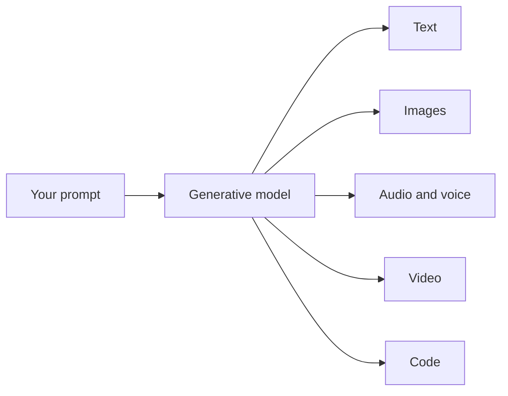

Generative AI is not one thing. The same basic idea - learn from a huge pile of examples, then generate new content from a prompt - has been applied to several different kinds of media. Knowing the landscape helps you understand where the text tools this course focuses on fit in.

## The main kinds

- **Text.** You type a request and get written words back: answers, drafts, summaries, explanations. This is the world of chat assistants like ChatGPT and Claude, and it is what the rest of this course is about.
- **Images.** You describe a picture in words and get an image back. Tools like Midjourney, DALL-E, and Stable Diffusion do this.
- **Audio and voice.** Turn text into natural-sounding speech, clone a voice, or generate music. ElevenLabs and Suno are examples.
- **Video.** Describe a scene and get a short video clip. Tools like Sora and Runway work this way. This is the newest and fastest-moving kind.
- **Code.** Describe what a program should do and get working code back. This is really a specialized form of text generation, and it powers coding assistants.

Every one of these takes a prompt and generates something new that fits it. The media changes, the core idea does not.

## Why this course is about text

Text is the most broadly useful kind at work, and by a wide margin. Almost every job involves reading, writing, explaining, and deciding, and a text model helps with all of it. Text tools are also where the biggest productivity gains for engineers and everyday professionals are right now.

So while it is worth knowing that image, audio, and video generation exist, this course spends its time on the text kind. Next: the specific piece of technology that makes text generation work.
