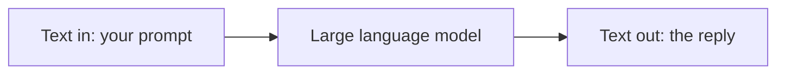

The text kind of generative AI runs on something called a **large language model**, or **LLM**. You will see that term constantly from here on, so it is worth a plain definition.

A large language model is a system trained on an enormous amount of written text - books, articles, code, conversations - until it learned the patterns in how language works. Once trained, it can take some text you give it and generate text that continues or answers it. "Large" refers to how much it learned from and how big the model is. "Language model" means its whole job is working with language.

## The one idea to hold onto

Everything a text tool does comes back to this: **an LLM takes text in and produces text out.**

- A **chat assistant** is an LLM with a chat box around it.
- A **coding assistant** is an LLM pointed at your code.
- A **summarizer** is an LLM asked to shorten something.

Different products, same engine underneath.

That is genuinely good news for learning. You do not have to master a hundred separate tools. You learn how to work with an LLM once, and that skill carries across all of them.

## What comes next

Now you have the big picture: generative AI creates new content, it comes in several kinds, and the text kind runs on LLMs. The next topic tours the actual tools you will run into - ChatGPT, Claude, Copilot, and the rest - so you know what is what before you start using one.
