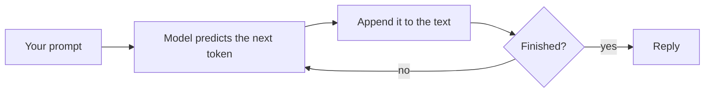

You have been using the term **large language model** since topic 01. Now look under the hood, because almost every quirk you will meet - different answers each time, confident mistakes, token limits - falls out of how these models work.

## A next-word predictor, at enormous scale

At its core, an LLM does one thing: given some text, it predicts what comes next. Not a whole answer at once - one small piece, called a **token** (next lesson). It adds that piece to the text and predicts again, over and over, until it decides the answer is finished.

That sounds too simple to write an essay or fix a bug. The trick is scale. To predict the next word well across billions of pages, the model had to absorb grammar, facts, styles of writing, how code fits together, and patterns of reasoning. Those patterns live in its **parameters** - billions of numbers adjusted during training.

## How a model is made

1. **Pre-training.** The model reads a huge slice of the internet, books, and code, learning to predict the next token. This is the expensive part: months of time on thousands of chips.
2. **Instruction tuning.** It is then trained on examples of helpful conversations, so it answers questions instead of just continuing text.
3. **Feedback training.** People and automated graders rate answers, and the model is nudged toward the helpful, honest, and safe ones.

The result is what you talk to in a chat assistant or call over an API.

## What this explains

- **It is not looking anything up.** There is no database of answers inside. It generates text that fits the patterns it learned.
- **Answers vary.** At each step the model has a set of likely next tokens and picks one with a little randomness (controlled by a setting called **temperature**). Ask twice, get two wordings.
- **It has a knowledge cutoff.** It only learned from data up to a date. Anything after that is unknown to it unless you supply it.
- **It can sound sure and be wrong.** Plausible is not the same as true - more in the last lesson of this topic.

Next: the tokens it reads and writes.
