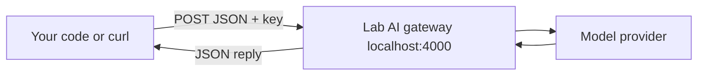

Chat apps are great for one person asking one question. Real AI work - sorting 10,000 tickets, explaining every alert, adding a summary button to your product - happens in **code**, and code talks to models through an **API**.

## What an API call is

An API call is an HTTP request. Your program sends a JSON document describing what it wants to a URL; the provider runs the model and sends JSON back. No browser, no chat window - just a request and a response your code can read.



## The two request shapes you will meet

Nearly every provider speaks one of two dialects, and the lab gateway speaks both:

| | OpenAI Chat Completions | Anthropic Messages |
|---|---|---|
| Endpoint | `POST /v1/chat/completions` | `POST /v1/messages` |
| Key header | `Authorization: Bearer <key>` | `x-api-key: <key>` |
| Input | `messages` array of `{role, content}` | same, plus a top-level `system` |
| Reply text | `.choices[0].message.content` | `.content[0].text` |
| Token counts | `.usage.prompt_tokens`, `.completion_tokens` | `.usage.input_tokens`, `.output_tokens` |

The OpenAI shape is the most widely copied - Google, Mistral, Groq, Ollama, and most gateways accept it - so this topic uses it. Topic 19 uses the Anthropic shape through its SDK.

## The lab gateway

Your practice machine runs an **AI gateway** on `http://localhost:4000`. It holds the real provider key, offers five models by stable names (`lab-mini`, `lab-fast`, `lab-smart`, `lab-reasoning`, `lab-open`), and records every request. Your shell has two variables for it:

```bash
echo $LAB_AI_URL                   # http://localhost:4000
[ -n "$LAB_AI_KEY" ] && echo set   # never echo the key itself
```

## Anatomy of a request

```bash
curl -sS "$LAB_AI_URL/v1/chat/completions" \
  -H "Authorization: Bearer $LAB_AI_KEY" \
  -H "Content-Type: application/json" \
  -d '{"model": "lab-fast",
       "messages": [{"role": "user", "content": "Say hello in five words."}]}'
```

- `model` picks which model answers.
- `messages` is the conversation so far - here, one user message.
- The key travels in a header, read from the environment, never typed into the command.

The reply is JSON. The text you want lives at `choices[0].message.content`, and `jq` pulls it out:

```bash
... | jq -r '.choices[0].message.content'
```

That path - request JSON in, `jq` the reply out - is what you will use constantly. Time to send one.
