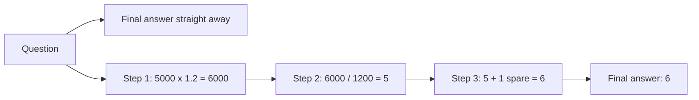

Ask a model a multi-step question and demand only the final answer, and it often gets it wrong. Ask it to work through the steps first, and accuracy goes up noticeably. This is one of the most reliable prompting techniques there is.

## Why it works

Remember how a model writes: one token at a time, each based on everything before it. When it jumps straight to a number, it has to produce that number in one step, with no working shown. When it writes out the steps, each intermediate result becomes text that the next step can build on.

Writing the steps is the model's scratch paper. It is the same reason you show your working in a maths exam: fewer slips, and when there is a slip, you can see where.

## Where it helps most

- Arithmetic and estimates (capacity, cost, time).
- Logic with several conditions ("if A and not B, unless C").
- Debugging: from symptom, to likely cause, to check, to fix.
- Any decision with trade-offs you want to see weighed.

It helps little on simple lookups ("what is the capital of France?") or pure writing tasks - and it costs more tokens, so do not use it everywhere.

## Reasoning models

Some models are trained to think before they answer, internally, without being asked. In the lab that is **`lab-reasoning`**. They do this kind of step-by-step work on their own, usually better and slower, and they bill the hidden thinking as output tokens. For everyday models like `lab-fast`, you get much of the same benefit by simply asking.

## A word of caution

The written steps are not a guarantee. A model can write convincing steps that contain an error, or reach the right answer with muddled steps. The value is that the reasoning is **visible** - you, or your code, can check it. Next: how to ask for reasoning in a way your script can still use.
