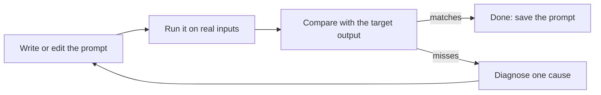

The refine loop is how a rough prompt becomes one you can rely on in a script. It is simple, and it works.

## The steps

1. **Define the target.** Write the exact output you want for one sample input.
2. **Run** the prompt on that input, and on two or three others - including an awkward one.
3. **Compare** each reply with the target. Note exactly what is wrong.
4. **Diagnose one cause** using the symptom table from the last lesson.
5. **Change one thing** and run again.
6. **Stop** when every test input gives an acceptable answer. Save the prompt in a file, not in your shell history.

## Make it repeatable

For anything a script depends on:

- Set **`temperature: 0`** so the same input gives (nearly) the same output, which makes comparisons fair.
- Keep the prompt in a **file** (`fixed.json`) under version control, like code.
- Keep the **test inputs** next to it.
- Check the output's shape in code, the way the checkers in this course do.

## A worked example

Target for an alert-parsing bot: exactly one line, `service=<name> status=<up|degraded|down> region=<code>`.

| Round | Reply | Diagnosis | Change |
|---|---|---|---|
| 1 | Three paragraphs about 503 errors | No format | Give the exact line format |
| 2 | `Service: Payments, Status: Down, Region: EU` | Format described loosely | Show a literal template and allowed values |
| 3 | `service=payments status=down region=EU` | Case not specified | Say "all values lower-case" |
| 4 | `service=payments status=down region=eu` | Matches | Save it |

Four short rounds, one change each. That is the loop you will run in the next task.

## Know when to stop rewording

If several rounds of clean, specific changes do not fix it, the problem may be the approach: give the model the missing data, split the task into two calls, add examples, or use a stronger model. Rewording forever is not the loop.
