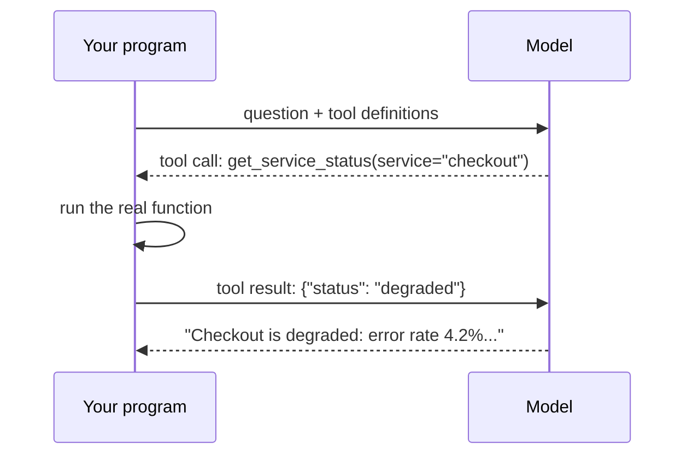

A model on its own can only produce text. It cannot check a server, read a database, or look at today's date. **Tool calling** (also called function calling) is how you let it ask your program to do those things.

## The idea

You describe a set of **tools** in your request - name, purpose, and the arguments each takes. When the model decides a tool would help, it does not answer in text. Instead it replies with a **tool call**: "please run `get_service_status` with `{"service": "checkout"}`".

**Your code** runs the tool, sends the result back, and the model uses it to write the final answer.



## The model never runs anything

This is the most important point. The model only **asks**. Your program decides whether to run the tool, runs it with its own permissions, and chooses what to send back. That is where you enforce safety: validate arguments, refuse dangerous calls, require approval.

## A tool definition

Tools are described with a JSON Schema for their arguments:

```json
{
  "type": "function",
  "function": {
    "name": "get_service_status",
    "description": "Get the current health of one production service.",
    "parameters": {
      "type": "object",
      "properties": {
        "service": {"type": "string", "description": "Service name, e.g. checkout"}
      },
      "required": ["service"]
    }
  }
}
```

The **description** matters more than you'd think: it is how the model decides when the tool is relevant. Write it the way you'd explain the function to a new colleague.

## What tools make possible

- **Fresh data**: status pages, metrics, tickets, the weather.
- **Actions**: create a ticket, restart a job, send a message.
- **Exact work**: maths, date arithmetic, database queries - things models do badly in their heads.

Tool calling is the foundation of agents (topic 21) and of MCP (topic 18). Next: the loop, step by step.
