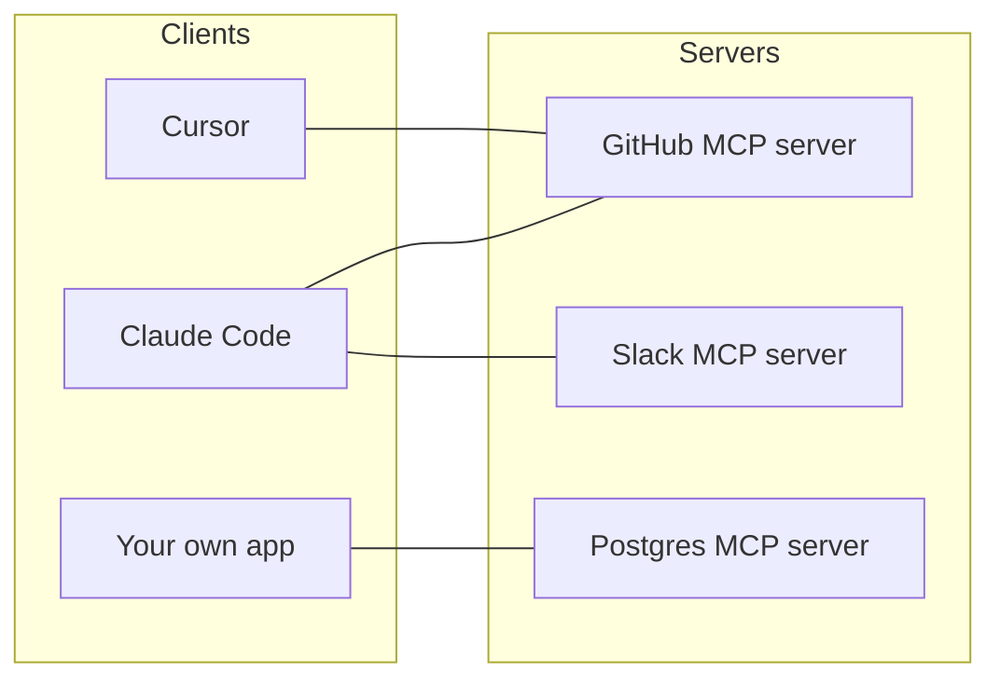

Every AI tool needs to connect to the same systems: GitHub, Slack, Jira, databases, file systems. Before 2025, each tool built each connection itself. The **Model Context Protocol (MCP)** fixes that: an open standard for connecting AI applications to tools and data.

## The USB-C idea

Write a connector once as an **MCP server**, and any **MCP client** can use it - Claude Code, Cursor, VS Code, ChatGPT, and many more.

## What a server offers

| Feature | What it is | Example |
|---|---|---|
| **Tools** | Functions the model can call (topic 16) | `create_issue`, `search_code` |
| **Resources** | Data the client can read | A file, a database schema |
| **Prompts** | Reusable prompt templates | "Review this PR" |

Most servers are mainly about **tools**. When you connect one, its tools appear to the model just like the `get_service_status` tool you wrote by hand - the client handles the loop.

## How clients reach servers

- **stdio** - the client starts the server as a local process and talks over stdin/stdout. Good for local tools: files, git, a local database.
- **HTTP** (streamable HTTP) - the server runs remotely at a URL. Good for SaaS: GitHub, Linear, Sentry. Usually authenticated with OAuth or a token header.

## Security first

An MCP server can do whatever its credentials allow. Before adding one:

- **Trust the source.** Use official servers or ones you have reviewed - a malicious server can feed the model hostile instructions or steal data.
- **Least privilege.** Give it a token with only the permissions it needs (read-only if possible).
- **Keep secrets out of files you commit.** Reference environment variables instead of pasting tokens.
- **Watch the approvals.** Clients ask before running tools; read what they want to do.
