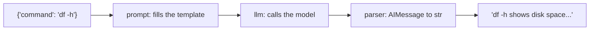

A **chain** connects steps so the output of one becomes the input of the next. In LangChain you build chains with the `|` (pipe) operator - the LangChain Expression Language, or LCEL.

## The three classic pieces

```python
from langchain_core.output_parsers import StrOutputParser
from langchain_core.prompts import ChatPromptTemplate

prompt = ChatPromptTemplate.from_messages([
    ("system", "You explain Linux commands to beginners in one sentence."),
    ("human", "Explain: {command}"),
])
parser = StrOutputParser()

chain = prompt | llm | parser
print(chain.invoke({"command": "df -h"}))
```

What happens on `invoke`:



1. The **prompt template** turns the dictionary into a list of messages.
2. The **model** sends them and returns an `AIMessage`.
3. The **parser** pulls out the text, so you get a plain string.

## Why this is useful

- **Reuse**: the same chain runs on 1 input or 10,000 (`chain.batch([...])`).
- **Streaming** for free: `for piece in chain.stream({...}): print(piece, end="")`.
- **Swappable parts**: change the model or parser without touching the rest.
- **Composable**: a chain can feed another chain.

## Templates and braces

Placeholders use `{name}`. If your prompt needs a literal brace - for example a JSON example - double it: `{{` and `}}`.

## Debugging

When a chain misbehaves, run each step alone:

```python
msgs = prompt.invoke({"command": "df -h"})
print(msgs.to_messages())     # exactly what the model will see
```

And remember the gateway log: `ailab log` shows every request the chain actually made.
