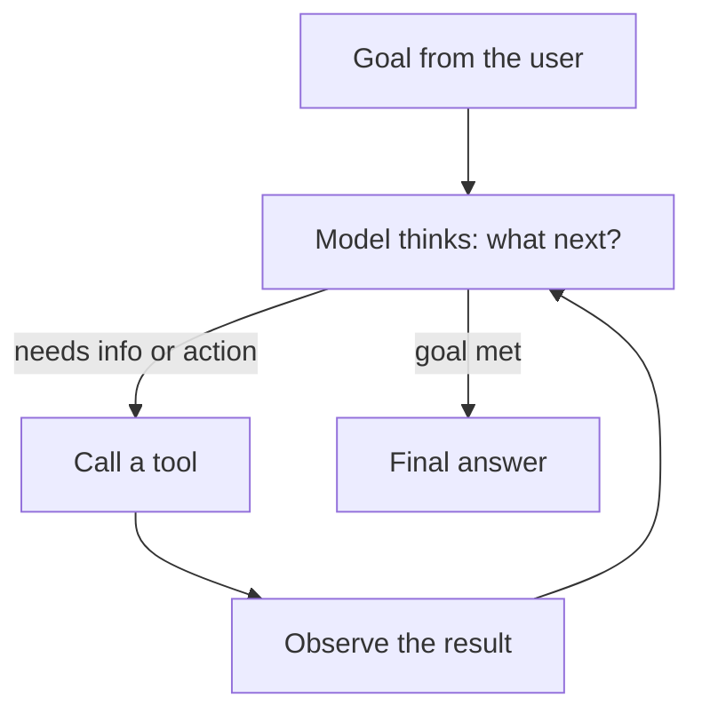

An **agent** is a model that decides **for itself** which tools to call, in what order, until a goal is done. You already built the core of one by hand in topic 16; an agent just runs that loop automatically.

## Chain vs agent

| | Chain | Agent |
|---|---|---|
| Steps | Fixed, decided by you | Decided by the model, at run time |
| Tools | Optional, called by your code | Called when the model chooses |
| Predictability | High | Lower |
| Good for | Known workflows | Open-ended tasks |

## The agent loop

Coding agents like Claude Code are exactly this: tools for reading files, editing them, and running commands, with a strong model in the loop.

## What makes an agent work well

1. **Good tools** - small, clearly named, well described, returning concise results.
2. **A clear goal and limits** in the system prompt: what it should do, and what it must not.
3. **A capable model** - weak models pick wrong tools or loop.
4. **Guardrails** - a maximum number of steps, timeouts, and human approval for risky actions.

## Risks to design for

- **Wrong actions**: an agent with a `delete` tool will eventually use it at the wrong moment.
- **Loops and cost**: each step is a model call; a confused agent can burn tokens fast.
- **Injected instructions**: a tool result (a web page, an email) can contain text telling the agent to do something else (topic 22).

The rule: give an agent the **least power** that gets the job done, start **read-only**, and log every tool call.
