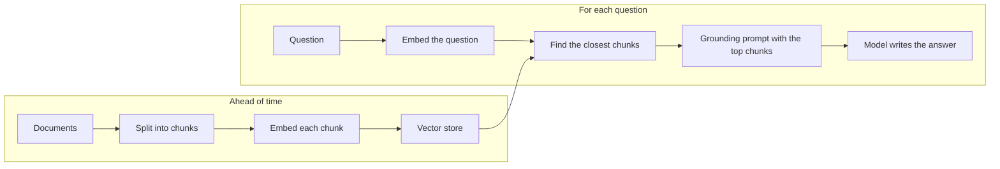

**RAG - Retrieval-Augmented Generation** - is grounding at scale. Instead of pasting all your documents into every prompt, you **retrieve** the few pieces relevant to the question, then let the model **generate** an answer from them.

## The pipeline

## The pieces

- **Chunking** - split documents into passages of a few hundred tokens, usually along headings or paragraphs, so each chunk is about one thing.
- **Embeddings** - an embedding model turns text into a list of numbers (a vector) that captures its meaning. Texts about similar things get similar vectors - "restart the service" lands near "how do I bounce payments-api?" even with no shared words.
- **Vector store** - a database that finds the nearest vectors fast: pgvector, Chroma, Qdrant, Pinecone, and others.
- **Retrieval** - embed the question, fetch the top few chunks (often 3-5).
- **Generation** - the grounding prompt from the last lesson, with those chunks as the document.

## Simple retrieval is fine to start

You don't need embeddings to learn RAG. **Keyword search** - score each section by how many question words it contains - works surprisingly well on small, well-structured docs like runbooks. Many production systems use **hybrid** search: keywords plus embeddings. You'll build the keyword version in project 26.

## What makes RAG good or bad

| Problem | Usual cause |
|---|---|
| Right answer exists but isn't found | Bad chunking, or the question uses different words (add embeddings) |
| Answer mixes up two services | Chunks too big, or no metadata filter |
| Confident wrong answer | No "not found" escape hatch in the prompt |
| Stale answers | Documents not re-indexed after changes |

## Cite sources

Return which chunks were used ("Sources: TLS certificates"). Users can check the answer, and you can debug retrieval.
