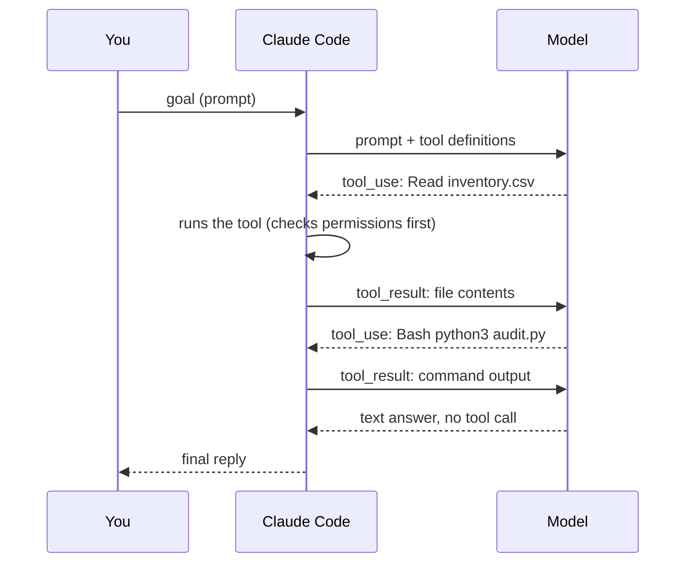

One sentence from you can turn into a dozen model calls. Understanding that loop is the key to reading what an agent did, why it took as long as it did, and why it stopped.

## One iteration of the loop



1. Claude Code sends the model your prompt plus a list of tools it may call.
2. The model answers with either text or a **tool_use** block - a request such as "Read this file" or "run this command".
3. Claude Code checks permissions, runs the tool, and sends the output back as a **tool_result**.
4. The model sees the result and decides the next step.

Each model response is a **turn**. A task with three tool calls and a final answer is four turns.

## Why the loop stops

| Reason | What you see |
|---|---|
| The model answers without asking for a tool | normal finish, `stop_reason: end_turn` |
| It hit `--max-turns N` | `subtype: error_max_turns` |
| It hit `--max-budget-usd` | `subtype: error_max_budget_usd` |
| A permission was refused in a headless run | the tool result says it was denied; the model carries on or gives up |
| You pressed Esc in the console | the turn is interrupted |

## Where the loop is recorded

Every session - console or `-p` - is saved as one JSON line per event under `~/.claude/projects/<folder>/<session-id>.jsonl`, where `<folder>` is the working directory with `/` turned into `-`. Assistant rows carry the `tool_use` blocks; user rows carry the `tool_result` blocks. That file is the full story of a run, and later checkers in this course read it.

```bash
ls ~/.claude/projects/
```

## Commands this node introduces

`ls ~/.claude/projects/` shows one folder per directory you have run Claude Code in.
