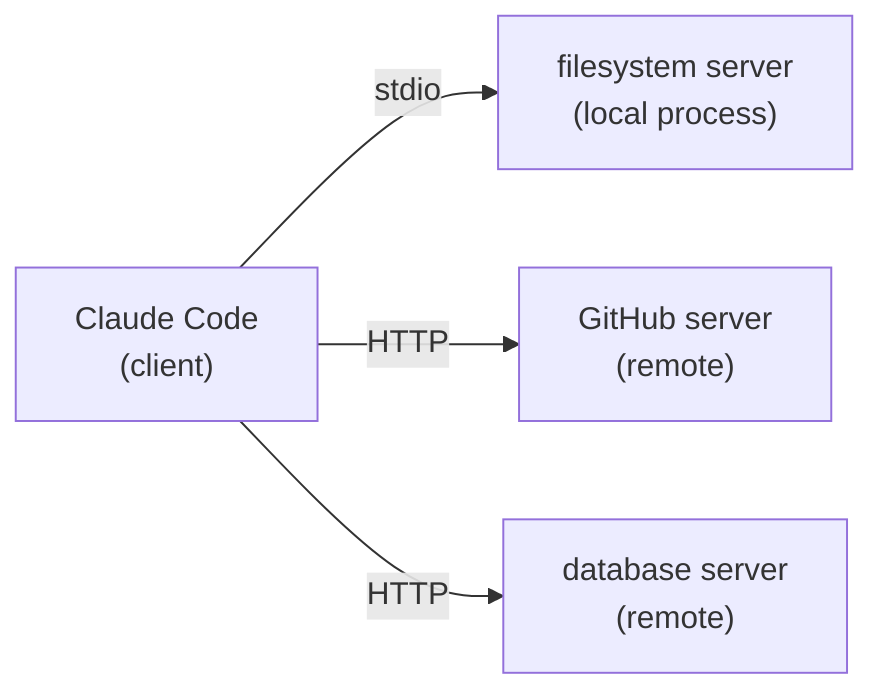

The **Model Context Protocol** is a standard way for an agent to use tools that live outside it. Claude Code is an MCP **client**; each **server** offers tools (and optionally resources and prompts), and Claude Code shows those tools to the model next to Read, Edit, and Bash.

## Why it matters

- **Reuse**: one server works in Claude Code, the Agent SDK, IDEs, and other agents.
- **Least privilege**: a server can expose exactly the operations a job needs - "query orders", not "run any SQL".
- **Off-the-shelf**: official servers exist for filesystems, GitHub, databases, browsers, and most SaaS tools.

## How Claude sees a server

Each tool appears as `mcp__<server>__<tool>`. Register the official filesystem server as `handbook` and Claude gets `mcp__handbook__read_text_file`, `mcp__handbook__list_directory`, `mcp__handbook__search_files`, and more. They go through the **same permission system** as built-in tools: allow them, deny them, or match them in hooks with `mcp__handbook__.*`.

With many servers, Claude Code loads tool definitions on demand (**tool search**) instead of filling the context with every schema up front.

## What a server can reach

A local stdio server runs **as you**, with your files and credentials. Install servers you trust, pin versions, and read what tools they expose before you enable them for a repository.

## Commands this node introduces

`mcp__<server>__<tool>` naming and the idea of MCP clients and servers.
