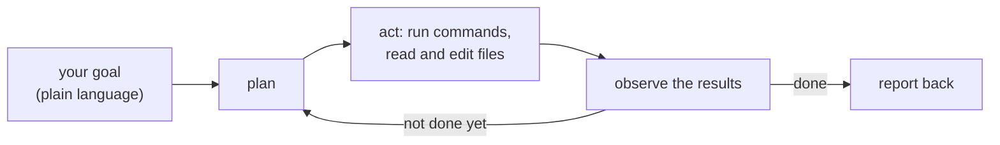

Claude Code is an AI coding agent that lives in your terminal. You give it a goal in plain language and it plans, runs commands, reads and edits files, and reports back - the same loop a human engineer runs, automated.

## Two ways to run it

| Mode | Command | When |
|---|---|---|
| Interactive console | `claude` | Working on a task together, back and forth |
| Headless (print mode) | `claude -p "prompt"` | Scripts, pipelines, one-shot answers |

Headless mode is the one that composes with everything else on Linux. Its answer goes to standard output, so you can pipe it into another command, save it to a file, or run it on a schedule with cron.

## Already set up in this lab

This VM has Claude Code preinstalled and signed in with your Claude account, so you can start working right away. You can pick which model answers with `/model` - **opus** for hard problems, **sonnet** for everyday work, **haiku** for quick questions. Nothing to configure.

## Permissions in one sentence

By default Claude asks before it touches your files or runs commands. In headless mode you grant that up front with `--permission-mode acceptEdits` (file edits allowed), and you stay in charge of everything else.

Next, verify the prerequisites on this machine.

> **Your lab setup:** this VM comes with Claude Code preinstalled and signed in - just run `claude` to start. (Setting up your own machine? Follow step 7 of `setup/README.md` once.)
