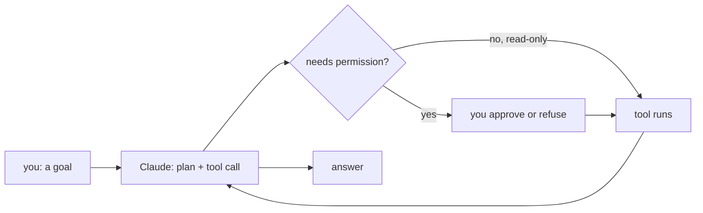

`claude -p` is great for one-shot jobs, but most of your day with Claude Code happens in the **interactive console**: you start it in a project folder, give it a goal, watch it work, and steer.

## Starting a session

```bash
cd ~/my-project
claude                # new session in this folder
claude -c             # continue the most recent session here
claude -r             # pick an older session to resume
```

The folder you start in matters. It becomes the **working directory**: Claude can read and edit files under it, and it loads that project's memory file (`CLAUDE.md`) and settings.

## What a turn looks like

You type a request and press Enter. Claude replies with text and **tool calls** - "Read tasks.py", "Bash: python3 -m unittest". Reading is allowed by default. Before it edits a file or runs a command, it shows you exactly what it wants to do and asks: **Yes**, **Yes, and don't ask again** for this kind of action, or **No** (and tell it what to do instead).



## Slash commands

Anything starting with `/` is a command for the console itself, not a message to the model.

| Command | What it does |
|---|---|
| `/help` | List every command |
| `/init` | Scan the project and write a starter `CLAUDE.md` |
| `/model` | Switch model: `opus`, `sonnet`, `haiku` |
| `/clear` | Start fresh: empty the conversation |
| `/compact` | Summarize the conversation to free up space |
| `/context` | Show what is using the context window |
| `/permissions` | See and edit what Claude may do without asking |
| `/exit` | Leave (or press Ctrl+D) |

## Keys worth knowing

| Key | Effect |
|---|---|
| `Esc` | Stop Claude mid-step - nothing is lost, you can redirect it |
| `Esc` `Esc` | Jump back to an earlier message and try again |
| `Shift+Tab` | Cycle permission modes (normal, accept edits, plan) |
| `@path` | Point at a file: "explain @tasks.py" |
| `!cmd` | Run a shell command yourself, output goes into the conversation |

## Two habits from day one

1. **Start in the right folder.** A session in your home directory sees everything you own; a session in the project sees the project.
2. **Interrupt early.** If the first tool call is heading the wrong way, press `Esc` and say so. Correcting step one is cheaper than undoing step ten.

Every console session is saved under `~/.claude/projects/`, which is how `claude -c` finds it again - and how this lab's checkers see what you did.
