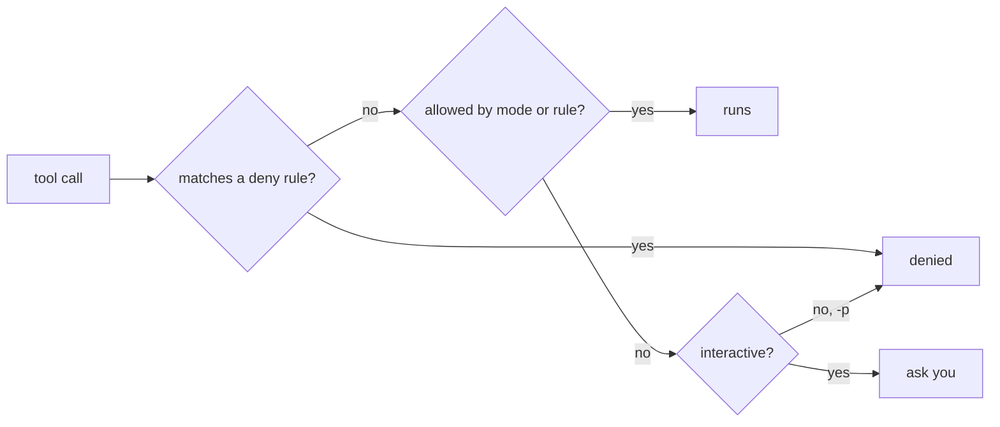

An agent that can run commands can also run the wrong command. Claude Code's answer is simple: **the model proposes, the harness decides.** Every tool call passes a permission check before anything happens.

## Three kinds of action

| Kind | Examples | Default |
|---|---|---|
| Read-only | Read a file, search, list | Allowed |
| File edits | Edit, Write | Ask first |
| Commands and network | Bash, WebFetch, MCP tools | Ask first |

When Claude asks, you see the exact command or diff and choose **Yes**, **Yes, and don't ask again** (for this command pattern in this project), or **No**. Saying no isn't an error - Claude gets told, and it adapts.

## Rules: allow, ask, deny

"Don't ask again" writes a **rule**. You can also write rules yourself in `.claude/settings.json`:

```json
{
  "permissions": {
    "allow": ["Bash(./run-tests.sh:*)", "Bash(git diff:*)"],
    "deny":  ["Bash(./deploy.sh:*)", "Read(./.env)"]
  }
}
```

The pattern is `Tool(specifier)`:

| Rule | Matches |
|---|---|
| `Bash(npm test)` | exactly that command |
| `Bash(git diff:*)` | any command starting with `git diff` |
| `Read(./.env)` | reading that file |
| `Edit(src/**)` | editing anything under `src/` |
| `WebFetch(domain:docs.python.org)` | fetching from that domain |
| `mcp__github` | every tool of the `github` MCP server |

**Deny always wins.** If one rule allows a command and another denies it, it's denied - no matter which file the rules came from. That makes deny rules a safe place for "never, ever" lines like `Bash(rm -rf:*)` or `Read(./secrets/**)`.

## Where you see and change them

- `/permissions` in the console lists every rule and where it came from, and lets you add or remove them.
- `--allowedTools` and `--disallowedTools` set rules for a single run: `claude -p "..." --allowedTools "Bash(git log:*)"`.

## Trusting a folder

The first time you open `claude` in a folder, it asks **"Do you trust the files in this folder?"** That matters because a repository can ship its own `.claude/settings.json`: until you say yes, Claude Code **ignores the project's allow rules** (deny rules always apply), so a cloned repo can't quietly grant itself `Bash(*)`.

## Headless runs can't ask

In `claude -p` there's nobody to click Yes. Anything not already allowed is **denied**, the model gets an error result, and the run's final JSON lists it under `permission_denials`. So headless runs are safe by default - and you grant exactly what the job needs.


