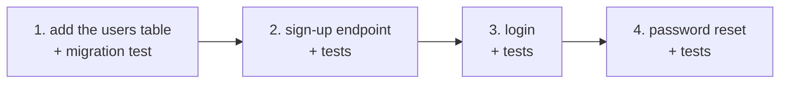

A clear brief can still be too big. "Add user accounts with login, password reset, email verification and an admin page" is clear - and it's four features, a database change and a security review in one request. One giant step means one giant diff, and when something in it is wrong, you have to find it.

## Signs a request is too big

- It contains "and" more than once: build X **and** migrate Y **and** update Z.
- You couldn't review the result in about five minutes.
- It touches parts of the system that have different owners or risks (UI vs database vs auth).
- You can't write a single "done when" check for it.

## Slice it

Split along steps that each leave the project working:

After each step: run the tests, read the diff, commit. Then start the next step - often with `/clear`, so the new step starts from a clean slate instead of a long, noisy conversation.

## The commit is your checkpoint

Small steps plus commits give you a cheap undo. If step 3 goes sideways, `git restore .` takes you back to the end of step 2 - not to the start of the day. Claude Code also keeps its own checkpoints you can rewind with `Esc` `Esc`, but git is the one that survives the session.

## Let Claude help you slice

You don't have to plan the slices alone. Ask:

> Here's the feature: (...). Break it into steps that each leave the tests passing. Don't write any code yet.

You'll meet **plan mode** in topic 8 - a mode where Claude can only read and propose, which is exactly right for this conversation.

## When one big step is fine

Mechanical changes that are the same everywhere - rename a function across the repo, update an import path, reformat files - are one step even when they touch fifty files, because you review them the same way: run the tests and skim the diff. Big but uniform is fine. Big and varied is what you slice.
