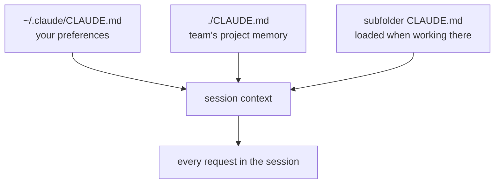

Every Claude Code session starts with a blank memory. It doesn't remember yesterday's conversation, the test command you told it last week, or that your team never uses floats for money. **CLAUDE.md** is how you fix that: a plain Markdown file that Claude Code reads at the start of **every** session and keeps in context the whole time.

## Where it lives

Claude Code looks for memory files in several places and loads all of them:

| File | Scope | Shared? |
|---|---|---|
| `./CLAUDE.md` (project root) | This project | Yes - commit it, the whole team gets it |
| `~/.claude/CLAUDE.md` | Every project on your machine | No - your personal preferences |
| `CLAUDE.md` in parent folders | Everything below that folder | Depends - useful in monorepos |
| `CLAUDE.md` in a subfolder | Loaded when Claude works in that subfolder | Yes |

More specific files add to the general ones; if they disagree, the more specific instruction usually wins in practice. Put personal style in `~/.claude/CLAUDE.md` and project facts in the project.



## How to create and edit it

- `/init` - Claude scans the repo and writes a starter `CLAUDE.md` (you did this in topic 2). A good first draft, never a finished one.
- Write or edit it by hand - it's just Markdown in git.
- `/memory` in the console opens the memory files in your editor.
- Ask Claude: "add to CLAUDE.md that integration tests need `docker compose up` first".

## Imports

A memory file can pull in another file with `@path`:

```markdown
See @README.md for the project overview and @docs/testing.md for test setup.
```

That keeps CLAUDE.md short while pointing at documents you maintain anyway.

## Why it works - and its limits

CLAUDE.md is part of the context, so it shapes every answer: Claude will run `./scripts/test.sh` instead of guessing `pytest`, and store money as cents because you said so. But it is **guidance, not enforcement**. A model can still miss an instruction in a long session. For rules that must never be broken - "never read `.env`", "never push to main" - use permission rules (topic 3) or hooks (topic 14), which the harness enforces.
