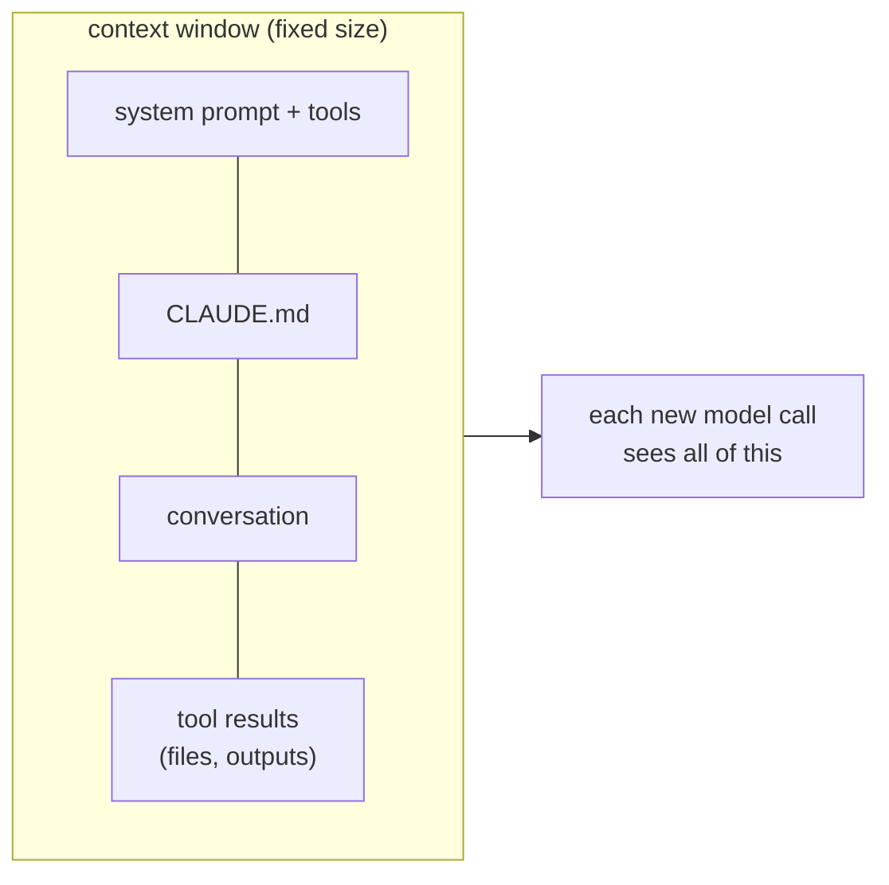

Everything Claude knows about your task right now lives in one place: the **context window**. It's the model's working memory for the session - and it fills up.

## What's in it

| Part | When it's added |
|---|---|
| Claude Code's system prompt and tool definitions | Always, at the start |
| Your CLAUDE.md files | Always, at the start |
| Every message you send | Each turn |
| Every reply and tool call | Each turn |
| **Tool results**: file contents, command output, search results | Each time a tool runs |

That last row is the big one. Reading a 2,000-line file, or a test run that prints 500 lines, can add more than a long conversation does.

## Why a full window is a problem

- **There's a hard limit** (around 200,000 tokens for most Claude models). Near it, Claude Code has to summarize old turns automatically to keep going.
- **Quality drops before the limit.** A window stuffed with old logs, abandoned approaches and unrelated files makes it harder for the model to focus on what matters now. It may cling to an idea you dropped an hour ago.
- **It costs more and runs slower.** Every model call re-reads the whole window.

## Seeing what's in yours

Type `/context` in the console. It shows how full the window is and what is taking up space - system prompt, memory files, tools, messages. Make it a habit when a session starts to feel slow or confused.

## Keeping it clean from the start

- **One task per session.** Unrelated work drags along unrelated context.
- **Point, don't paste.** "Look at the errors in `logs/app.log` from 09:00 to 09:10" beats pasting the whole log.
- **Ask for focused reads.** "Read the `charge()` function in payments.py" rather than "read the payments package".
- **Use subagents for big searches** (topic 13): they explore in their own context and return only the answer.

When the window is cluttered anyway, you have two tools: `/clear` and `/compact`. That's next.
