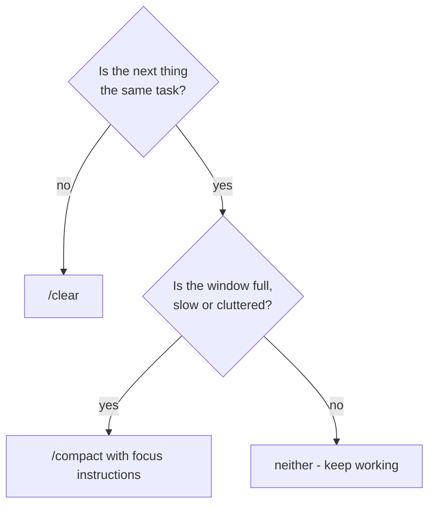

Two commands manage the context window. They solve different problems, and picking the wrong one is a common mistake.

| | `/clear` | `/compact` |
|---|---|---|
| What happens | The conversation is emptied | The conversation is replaced by a summary |
| What Claude still knows | Only CLAUDE.md and the system prompt | The summary: decisions, progress, open items |
| Use it when | Switching to a **different** task | Continuing the **same** task with less clutter |
| Cost | Free, instant | One model call to write the summary |

## /clear: a fresh start

`/clear` is like opening a new session in the same folder. Use it:

- after finishing and committing a task, before the next one;
- when moving to unrelated work;
- when the conversation is polluted - a huge pasted log, a dead-end approach - and nothing in it matters for what's next.

Your CLAUDE.md is loaded again, so project knowledge survives. Anything you only said in conversation doesn't - which is a good prompt to move lasting facts into CLAUDE.md.

## /compact: same task, less weight

`/compact` asks Claude to summarize the conversation so far and continue from that summary. Use it when you're **mid-task** and the window is getting full or slow, but the history still matters.

You can steer the summary with instructions:

```
/compact keep the list of tables already migrated and the naming rule we agreed; drop the debugging output
```

Without instructions, Claude decides what's important. With them, you make sure the decisions you care about survive. Claude Code also compacts **automatically** when the window is nearly full - but a manual `/compact` at a natural break, with your own focus, keeps more of what matters.

## Choosing



Doing neither is a valid answer: a session two minutes old doesn't need managing.
