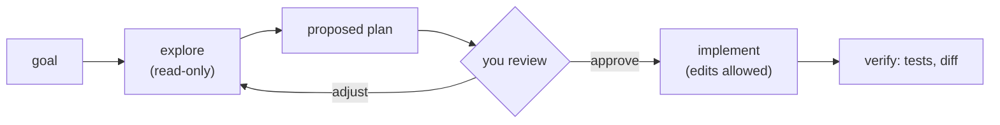

For small, clear changes you let Claude act right away. For anything bigger or riskier - a refactor, a change in code you don't know, a migration - you want to see the approach **before** a single file changes. That's **plan mode**.

## What changes in plan mode

In plan mode Claude can only use **read-only** tools: read files, search, list directories, look at git history. Edits, file writes and commands that change things are blocked by the harness - not by politeness. Claude explores, then presents a **plan**: which files it would change, in what order, and how it would check the result.

## Getting into plan mode

- **Console:** press `Shift+Tab` until the footer says plan mode, or start with `claude --permission-mode plan`.
- **Headless:** `claude -p "..." --permission-mode plan` - the answer is the plan, and any attempted edit shows up in `permission_denials`.

When the plan is ready in the console, Claude asks whether to proceed. You can approve it, or keep refining: "use a dataclass instead", "do the tests first", "don't touch the CLI flags".

## Why it's worth the extra step

- **Cheap course corrections.** Fixing a wrong approach in a plan costs one message. Fixing it after 15 edited files costs an afternoon.
- **You learn the code.** The exploration phase is a guided tour of the module you're about to change.
- **Better results.** Asking for a plan first makes the model think through the whole change before it starts typing, instead of discovering problems halfway through.
- **A reviewable artifact.** Save the plan (`PLAN.md`) and you have something a teammate can comment on - or that a later session can implement exactly.

## What makes a good plan

- Names the files and functions to create or change.
- Orders the steps so the project keeps working after each one.
- Says how to verify: which tests, which command, what output should stay the same.
- Calls out risks and open questions ("`main()` is also imported by `cron.py`").

If a plan is vague - "refactor for clarity" - ask for specifics before approving.

## When to skip it

Typos, one-line fixes, and changes you've already fully specified don't need a plan. Plan mode is for when you'd want to see the approach from a human teammate before they started.
