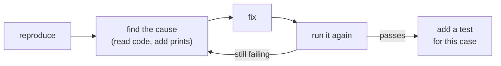

Debugging is where an agent that can **run things** shines. A chat assistant can only guess from the code you paste; Claude Code can reproduce the failure, read the code around it, try a fix, and run it again.

## Give it the evidence

The best bug report for Claude is the same as for a human - what you ran, what happened, what you expected:

```bash
python3 csv_total.py data/orders.csv 2> error.txt
claude -p "csv_total.py crashes on data/orders.csv with the error below. Find the root cause and fix it, then run it again to confirm.

$(cat error.txt)" --permission-mode acceptEdits --allowedTools "Bash(python3 csv_total.py:*)"
```

- **The full traceback or test output**, not "it doesn't work".
- **The command that reproduces it**, so Claude can run it too.
- **What correct looks like**: "should print `total: 1549.75`".
- **What you already know**: "only happens with names that contain commas".

## The loop



Allow the reproduce command with `--allowedTools` (or approve it in the console) so Claude can close the loop itself. A fix that wasn't re-run is a guess.

## Root cause, not symptom

Agents, like rushed humans, sometimes "fix" the symptom: wrap the line in `try/except: pass`, skip the row that crashes, or special-case the one input in the error. Ask for the root cause explicitly - and then read the fix:

- Did it change **why** it fails, or only stop the crash?
- Would a similar input break it again?
- Did it delete or weaken a test to make it pass? (Check `git diff` on test files.)

## Failing tests are the best bug reports

If you can write a test that fails, do - then ask Claude to make it pass **without changing the test**. The test defines "fixed", stays in the suite, and stops the bug coming back.

## When Claude is stuck

If it's going in circles - trying the same fix, adding more and more special cases - stop it (`Esc`), `/clear`, and restart with what you've learned: "the bug is in how the file is split into lines; it isn't the float conversion". A fresh context with a sharper description often beats a long, confused session.
