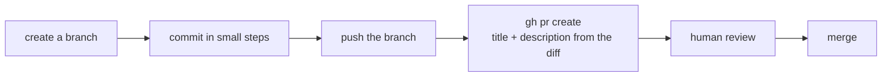

Claude Code is good at the git chores around coding: reading history, writing commit messages from the actual diff, and preparing pull requests. The rule that keeps it safe is simple - **Claude prepares, you review, and nothing lands without you.**

## Reading history

Questions about history are read-only and very useful:

- "What changed in the last five commits, and why?"
- "Who last changed the discount logic, and what was the commit message?" (`git log -L`, `git blame`)
- "Summarize what's on this branch compared with main."

## Commits from the diff

Claude reads `git diff` and writes a message that describes what actually changed - often better than the `fix stuff` you'd type at 6pm:

> Look at the uncommitted changes, then stage and commit them with a Conventional Commits message.

Conventional Commits is a common format: `type: summary` (or `type(scope): summary`), where type is `feat`, `fix`, `docs`, `refactor`, `test` or `chore`, and the summary is short and imperative - `feat: add farewell greeting`. Teams use it to generate changelogs and version numbers.

Claude Code may add a co-author line to commits it makes. Teams that don't want it can turn it off in settings.

## Branches and pull requests

With the GitHub CLI (`gh`) installed and logged in, Claude can take the whole flow:

> Create a branch `fix/rounding`, commit the fix, push it and open a PR with a description of the change and how it was tested.

The PR description is where Claude's summary shines - and where your reviewers see what was done.

## Permissions for git

A sensible setup for most projects:

| Rule | Why |
|---|---|
| allow `Bash(git status:*)`, `Bash(git diff:*)`, `Bash(git log:*)` | Read-only, run them freely |
| ask (default) for `git add`, `git commit`, `git push` | You see each one |
| deny `Bash(git push --force:*)`, `Bash(git push origin main:*)` | Never rewrite shared history or skip review |

In headless runs, grant exactly what the job needs: `--allowedTools "Bash(git diff:*)" "Bash(git commit:*)"`. Leave `git push` out unless the job is specifically to push a branch.

## Review before anything lands

- Read the diff yourself before approving a commit - the message describes the change; the diff **is** the change.
- Check what got staged: `git show --stat HEAD`. Agents sometimes include stray files.
- Prefer a PR and a human review over pushing to main, even for small fixes.
