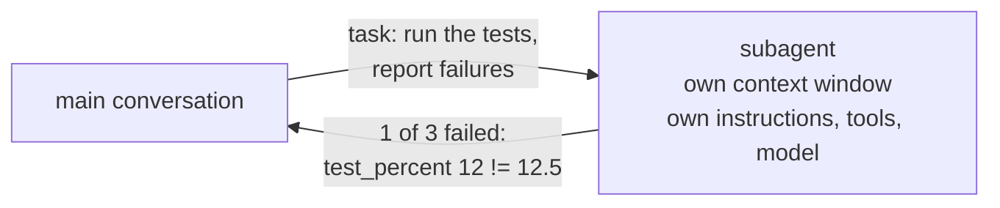

Some jobs make a mess of the context window: running a test suite with 400 lines of output, searching 60 files for every use of a config key, reading a long log. You need the **conclusion**, not the mess. A **subagent** is a helper Claude can hand that job to.

## How it works



The subagent starts with a **fresh context**: its own system prompt (your instructions), only the tools you give it, and optionally a different model. It does the work - all the noisy reading and running happens in **its** window - and returns a short report. The main conversation only receives that report.

## Why use them

- **Clean main context.** The 400 lines of test output never enter your session.
- **Focus.** A subagent with one job and one set of instructions does that job consistently.
- **Least privilege.** A test runner needs `Bash` and `Read`, not `Write`. A reviewer needs to read, not edit.
- **Right model for the job.** Run a quick, mechanical job on haiku and keep opus for the main thread.
- **Parallel work.** Claude can run several subagents at once - for example, one per module to review.

## Built-in and custom

Claude Code comes with general helpers - **general-purpose** for multi-step jobs, **Explore** for read-only searching, **Plan** for research in plan mode. You add your own as Markdown files:

| Location | Available |
|---|---|
| `.claude/agents/<name>.md` | In this project - commit it for the team |
| `~/.claude/agents/<name>.md` | In all your projects |

The `/agents` command in the console lists them and walks you through creating one.

## Anatomy of a subagent file

```markdown
---
name: test-runner
description: Runs the project's unit tests and reports which tests fail and why. Use when asked to run or check the tests.
tools: Bash, Read
model: haiku
---
You run tests and report back. You never edit files.
Run `python3 -m unittest discover -s tests -v` and report the failures.
```

| Field | Meaning |
|---|---|
| `name` | How you and Claude refer to it |
| `description` | **When** to use it - Claude reads this to decide whether to delegate |
| `tools` | Allowed tools; leave it out to inherit all of the main session's tools |
| `model` | `haiku`, `sonnet`, `opus`, or `inherit` |
| Body | The subagent's instructions (its system prompt) |

## Calling one

- **Explicitly:** "Use the test-runner subagent to run the tests."
- **Automatically:** Claude delegates when a task matches the description. Phrases like "use proactively" make that more likely.

Remember the subagent only knows what's in its prompt and instructions - not your conversation. Put everything it needs in the task you give it, or in its file.
