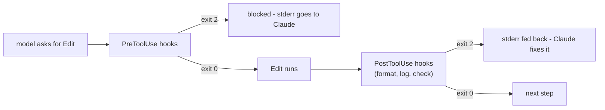

CLAUDE.md asks; permission rules allow or block. **Hooks** go one step further: they run **your own commands** automatically at fixed points in Claude Code's loop. Format every file Claude edits. Block a command before it runs. Log every tool call. Ping you when Claude needs input. The model can't skip them, because the harness runs them, not the model.

## Lifecycle events

| Event | Fires | Typical use |
|---|---|---|
| `PreToolUse` | Before a tool runs | Block dangerous commands, protect files |
| `PostToolUse` | After a tool succeeds | Format, lint or test what was just edited; log |
| `UserPromptSubmit` | When you send a prompt | Add context, block prompts with secrets |
| `Notification` | When Claude needs your attention | Desktop or chat notification |
| `Stop` | When Claude finishes its answer | Run tests, refuse to stop until they pass |
| `SubagentStop` | When a subagent finishes | Check its result |
| `SessionStart` / `SessionEnd` | Session begins / ends | Load context, clean up |
| `PreCompact` | Before compaction | Save the transcript |



## Configuring a hook

Hooks live in settings files - `.claude/settings.json` for the project, `~/.claude/settings.json` for you:

```json
{
  "hooks": {
    "PostToolUse": [
      {
        "matcher": "Edit|Write",
        "hooks": [
          {"type": "command", "command": "python3 \"$CLAUDE_PROJECT_DIR/.claude/hooks/log_edit.py\""}
        ]
      }
    ]
  }
}
```

- `matcher` is a regular expression on the **tool name** (`Bash`, `Edit|Write`, `mcp__github__.*`). Leave it out (or use `*`) to match every tool.
- `$CLAUDE_PROJECT_DIR` is the project root - use it so the hook works from any folder.
- `/hooks` in the console shows what's configured.

## What a hook receives and returns

The hook gets a JSON object on **standard input**: `session_id`, `cwd`, `hook_event_name`, and for tool events `tool_name` and `tool_input` (for Edit and Write, `tool_input.file_path`). PostToolUse also gets `tool_response`.

Its **exit code** is its answer:

| Exit code | Meaning |
|---|---|
| `0` | Fine - carry on |
| `2` | Block (PreToolUse) or push back (PostToolUse): **stderr is sent to Claude**, which reacts to it |
| anything else | A hook error - shown to you, but the work continues |

So a PostToolUse hook that exits 2 with "app/hello.py does not compile" makes Claude go back and fix the file - automatically.

## Hooks run with your permissions

A hook is a shell command that runs as you, with your files and credentials. Read project hooks before you trust a repository, keep hook scripts short and in git, and never pipe tool input into a shell unquoted.
