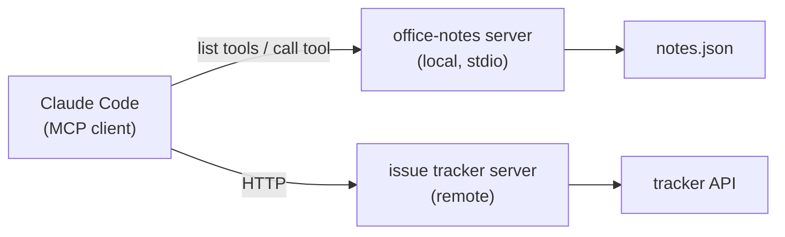

Out of the box, Claude Code can read files, edit them and run shell commands. Your real work also lives in other places: the issue tracker, the database, monitoring, internal docs, a design tool. The **Model Context Protocol (MCP)** is the standard plug that connects Claude Code to those systems.

## The idea

An **MCP server** is a small program that exposes **tools** (and sometimes resources and prompts) in a standard format. Claude Code is an **MCP client**: it starts or connects to the server, asks what tools it has, and offers them to the model next to the built-in ones.



Write the server once, and every MCP client - Claude Code, IDEs, other agents - can use it. Many products publish official MCP servers.

## Transports

| Transport | What it is | Example |
|---|---|---|
| `stdio` | Claude Code starts the server as a local process and talks over stdin/stdout | `python3 notes_server.py` |
| `http` | A server running somewhere else, reached by URL (often with OAuth sign-in) | `https://mcp.example.com/mcp` |

## Managing servers from the command line

```bash
claude mcp add office-notes -- python3 /path/notes_server.py      # stdio server
claude mcp add --transport http tracker https://mcp.example.com/mcp   # remote server
claude mcp list                  # every server and whether it's connected
claude mcp get office-notes      # details for one
claude mcp remove office-notes   # take it away
```

Everything after `--` is the command that starts a stdio server. Inside the console, `/mcp` shows server status and handles sign-in for remote servers.

## Scopes: who gets the server

| `--scope` | Stored in | Who gets it |
|---|---|---|
| `local` (default) | Your user config, for this project only | Just you, in this project |
| `project` | `.mcp.json` in the repo - commit it | Everyone who clones the repo (each person approves it once) |
| `user` | Your user config | You, in every project |

## Tools from servers

MCP tools show up named `mcp__<server>__<tool>`, for example `mcp__office-notes__search_notes`. They go through the same permission system as everything else: allow them with `--allowedTools "mcp__office-notes__search_notes"` (or `mcp__office-notes` for all of that server's tools), deny them, or approve them when asked.

## Think before you connect

- A server runs code (local) or holds credentials (remote). Use servers from sources you trust.
- Tool results are **untrusted input**: a ticket or web page returned by a server can contain instructions aimed at the model. Keep write actions behind permissions.
- Give each server the narrowest access that does the job - read-only tokens where possible.
