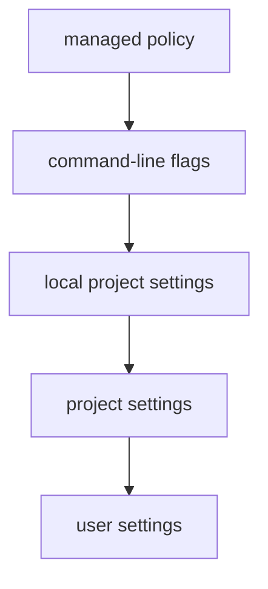

Claude Code's behavior - which model it uses, what it may do, which hooks run - comes from **settings files**. There are several, at different levels, so a company, a team and a single developer can each set what's theirs to set.

## The files

| Level | File | Shared? | Typical contents |
|---|---|---|---|
| Managed (enterprise) | `/etc/claude-code/managed-settings.json` on Linux | Set by IT | Policies nobody can override |
| User | `~/.claude/settings.json` | Just you, every project | Your preferred model, personal tools |
| Project | `.claude/settings.json` | Committed - the whole team | Permission rules, hooks, project model |
| Local project | `.claude/settings.local.json` | Just you, this project - **not committed** | Your personal allowances for this repo |

Command-line flags (`--model`, `--allowedTools`, `--permission-mode`) apply to a single run.

## Who wins

For a single value like `model`, the more specific level wins:



Read it top-down: managed settings beat everything, then flags, then `settings.local.json`, then the project's `settings.json`, then your user file.

Permission rules **combine** from every level instead of replacing each other - and a `deny` anywhere beats an `allow` anywhere. That's how a company can forbid `Bash(curl:*)` once in managed settings and no project file can turn it back on. (And remember topic 3: a project's **allow** rules only apply once you've trusted the folder.)

## Common keys

```json
{
  "model": "haiku",
  "permissions": {
    "allow": ["Bash(python3 -m unittest:*)"],
    "deny": ["Read(./.env)", "Bash(curl:*)"],
    "defaultMode": "acceptEdits"
  },
  "env": {"PYTHONDONTWRITEBYTECODE": "1"},
  "hooks": {}
}
```

| Key | What |
|---|---|
| `model` | Default model alias (`opus`, `sonnet`, `haiku`) or full model name |
| `permissions` | `allow`, `ask`, `deny` rules, `defaultMode`, `additionalDirectories` |
| `env` | Environment variables for every session |
| `hooks` | Topic 14 |

## The model has its own pecking order

Which model answers is decided, in order, by: `/model` during the session, then `--model` at start-up, then the **`ANTHROPIC_MODEL` environment variable**, then the `model` setting. So if your machine exports `ANTHROPIC_MODEL` (the lab gateway setup does), it outranks every settings file. To see the settings file take effect, run with that variable removed: `env -u ANTHROPIC_MODEL claude -p "..."`.

## Shared vs personal

- Things the **team** should have - deny rules for secrets and deploys, the hook that formats code, the test command allowed - go in `.claude/settings.json` and get reviewed like code.
- Things that are **yours** - "I'm fine with Claude running `git status` without asking" - go in `.claude/settings.local.json`, which must stay out of git. Add it to `.gitignore`.

## Seeing what's in effect

In the console, `/permissions` shows every rule and which file it came from, `/config` shows and changes settings, and `/model` shows the current model. When something behaves unexpectedly, those three answer "where is this coming from?".
