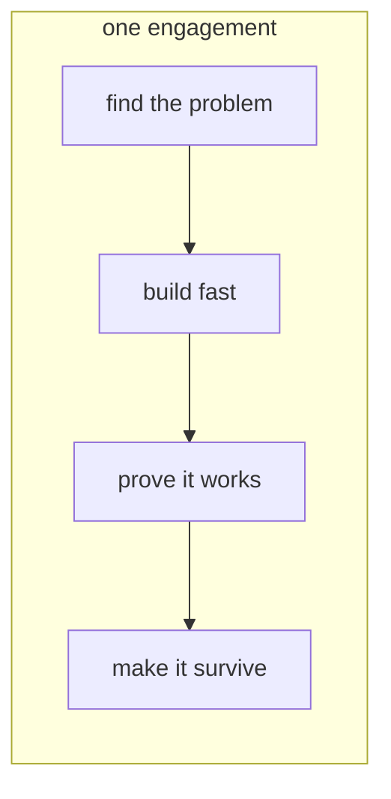

In this lesson you will learn what an AI Forward Deployed Engineer (FDE) is, why companies need one, and the four responsibilities that make up the role.

Imagine a bank buys access to a powerful AI model. The demo they saw was impressive: it answered questions, wrote summaries, sounded smart. Three months later, nothing has changed inside the bank. Nobody built anything with it.

Why? Because the model alone is not a solution. The bank's documents sit in ten different systems. Half of them are scanned PDFs. The compliance team will not let customer data leave the building. And nobody on the bank's staff has ever called an AI API.

Someone has to close that gap. That someone is the FDE.

## Forward deployed means you go to the customer

Most engineers build a product once and many customers use it. An FDE works the other way around. You are sent "forward", into one customer's world, and you build the solution there, inside their systems, with their data, next to their people.

One month you are at the bank building a document assistant. The next engagement is a logistics company that wants help answering support tickets. Same model underneath, completely different problem each time.

## Four primary responsibilities

A typical FDE role involves 4 primary responsibilities:

1. **Find the right problem.** Sit with the customer and pick a use case where AI actually helps. Saying no to bad ideas is a big part of this.
2. **Build fast.** Connect the model to the customer's documents and APIs, and get a working version in front of real users in days, not months.
3. **Prove it works.** "It looks good" is not proof. You build tests that measure how often the answers are right, and you show the numbers to the customer.
4. **Make it survive.** Add cost limits, safety rules, and logging, then teach the customer's team to run it after you leave.

Notice something: only one of those four is "write code that calls a model". The rest is data plumbing, measurement, and working with people. That mix is the job.

This whole skill follows that same path. You start from zero, learn how models work, then build, measure, and harden real solutions. In the next lesson: a scenario. A customer asks you to "add AI everywhere", and you decide what to say.
