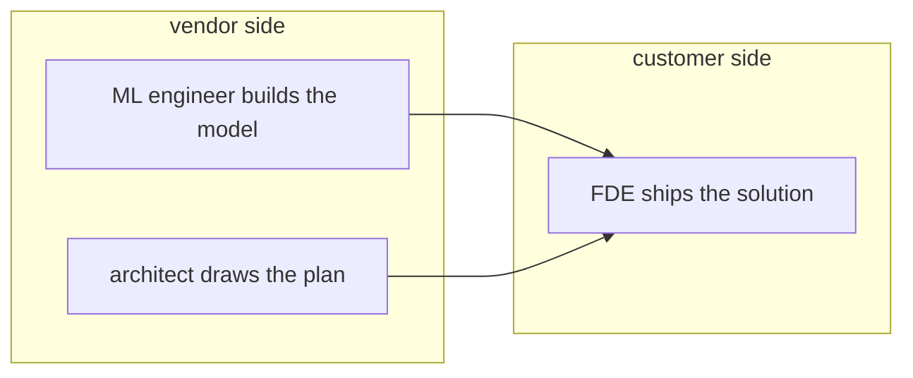

In this lesson you will learn how the FDE role differs from two roles that sound similar: the solutions architect and the ML engineer. Knowing the difference tells you what is your job and what is not.

Picture the bank from the first lesson again. Three people from the AI vendor might show up there. They look alike on a slide. They do very different work.

## The solutions architect advises

A solutions architect draws the plan. They meet the bank's IT leaders, review the systems, and produce diagrams and recommendations: "put the model here, connect these two systems, budget for this."

Then they leave. Someone else has to build it. The architect rarely opens a terminal at the customer site.

## The ML engineer builds models

An ML engineer works on the model itself: training it, tuning it, making it faster and cheaper to run. They usually sit at the vendor's office, far from any single customer, and their work helps every customer at once.

Ask an ML engineer about the bank's scanned PDFs and they will shrug. That mess is not their layer.

## The FDE ships the solution

The FDE takes the model the ML engineer built, follows a plan like the one the architect drew, and actually makes it work at the bank. Writing the code, cleaning the data, testing the answers, sitting with the compliance team. The FDE is measured on one thing: does the customer have a working solution?

A simple test to keep them apart. Who wrote the deployed code at the customer? The FDE. Who decided the model's training data? The ML engineer. Who recommended the overall shape? The architect.

Careful though: at small vendors one person may wear two of these hats. The roles still separate cleanly by question: advise, build the model, or ship the solution.

Next up: a scenario about what happens when the model itself gives weak answers, and whose problem that is.
