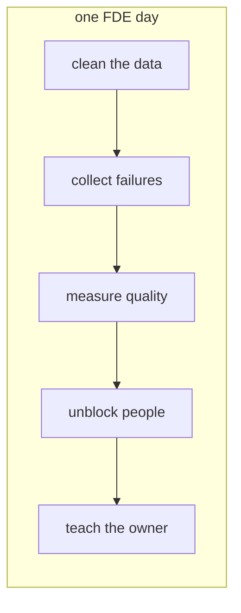

In this lesson you will learn what FDE work actually feels like hour by hour, so the four responsibilities stop being abstract.

Here is a real-shaped Tuesday, week three of an engagement at a logistics company. The project: an assistant that answers support agents' questions about shipping rules.

## Morning: data plumbing

**9:00.** You start where you left off: the customer's shipping rules live in a wiki export, and a quarter of the pages are empty templates. You write a small script to filter them out. Unglamorous work, and it decides the quality of every answer the assistant will ever give.

**10:30.** A support team lead drops by. You show the assistant a question from yesterday's real tickets. It answers well. The lead tries a trick question, and the assistant confidently gives a wrong rule. You write the failing question down. That list is gold.

## Afternoon: measurement and people

**13:00.** You add yesterday's failing questions to your test set, which is now 40 questions with known correct answers. You run it: 33 right, up from 29 last week. That number, not a demo, is what you will show in Friday's review.

**15:00.** Meeting with the customer's security engineer. She wants to know exactly what data leaves their network. You walk her through the request flow and agree to add logging she can inspect. Thirty minutes of talking that saves the project, because without her approval nothing ships.

**16:30.** You pair with Priya, the customer engineer who will own the system after you leave. She writes the code today, you watch and answer. Slower than doing it yourself. That is the point.

Count the hours spent writing prompts or calling the model: almost none. Most of the day was data, measurement, and people. The model work happens in short bursts between all of that.

Notice also that every activity maps back to the four responsibilities. Cleaning data is "build fast". The test set is "prove it works". Priya is "make it survive".

Next: a quick quiz to check what stuck about the role.
