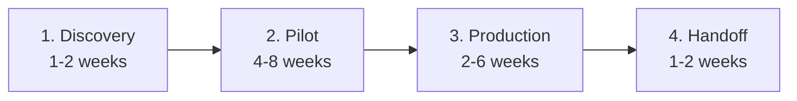

Every FDE engagement, whatever the customer, moves through the same four stages. Knowing them tells you where you are, what the customer expects next, and which work can wait.

## 1. Discovery

You learn the customer's world before writing real code. Interview the people who would use the assistant, read their documents, look at real tickets or emails, and find out where the data lives and who controls it. The output is a **scoped use case**: one problem, who it helps, how you will measure success, and what data you need.

Discovery is also where you **say no**. If the use case needs data nobody can give you, or success can't be measured, it's cheaper to find out now than in week six.

## 2. Pilot

You build a working version and put it in front of a **small group of real users** - ten support agents, not the whole company. You collect their failures, build a test set, and measure progress weekly. The pilot answers one question: *does this actually help, by the measure we agreed?*

## 3. Production

The pilot proved value; now you make it safe to run for everyone. Cost limits, guardrails, logging, monitoring, access control, security review, and scale. This is the work demos skip and customers remember.

## 4. Handoff

The customer's own team takes over. You write the runbook, train the owners, agree on who gets paged when something breaks, and leave. A good handoff means the system keeps improving after you're gone.

## Stages overlap a little

You'll find new failure cases during production, and handoff training should start during the pilot (remember Priya). But each stage has a clear purpose, and skipping one always shows up later - usually as a bill, an incident, or an abandoned tool.
