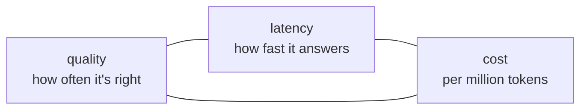

Every model choice trades three things against each other:

| Tier | Quality | Latency | Cost per million tokens (in / out) |
|---|---|---|---|
| Small (`lab-mini`) | Good at simple, well-specified tasks | Fastest | Lowest - often under $0.20 / $1 |
| Mid (`lab-fast`) | Strong on most business tasks | Fast | Low |
| Large (`lab-smart`) | Best at hard reasoning, long or messy inputs | Slower | 10-30x the small tier |
| Reasoning (`lab-reasoning`) | Best at multi-step problems; "thinks" first | Slowest - seconds to minutes | Highest, and uses extra hidden tokens |

You can usually have two of the three. A large model that's fast is expensive; a cheap fast model is less capable on hard questions.

## Latency has two parts

- **Time to first token** - how long until the answer starts. Matters most for chat, where users watch the screen.
- **Total time** - first token plus generation. Grows with answer length.

For a support agent answering a customer on the phone, two seconds feels long. For a nightly batch job summarizing 10,000 tickets, nobody cares about seconds - only about the bill.

## Measure, don't assume

Published benchmarks tell you how a model does on someone else's tasks. Your customer's task is different. The FDE habit:

1. Pick two or three candidate models.
2. Run the same realistic prompts through each.
3. Compare quality (later, with evals), latency and cost.
4. Choose the **cheapest model that meets the quality bar**.

You'll do the latency part now.
