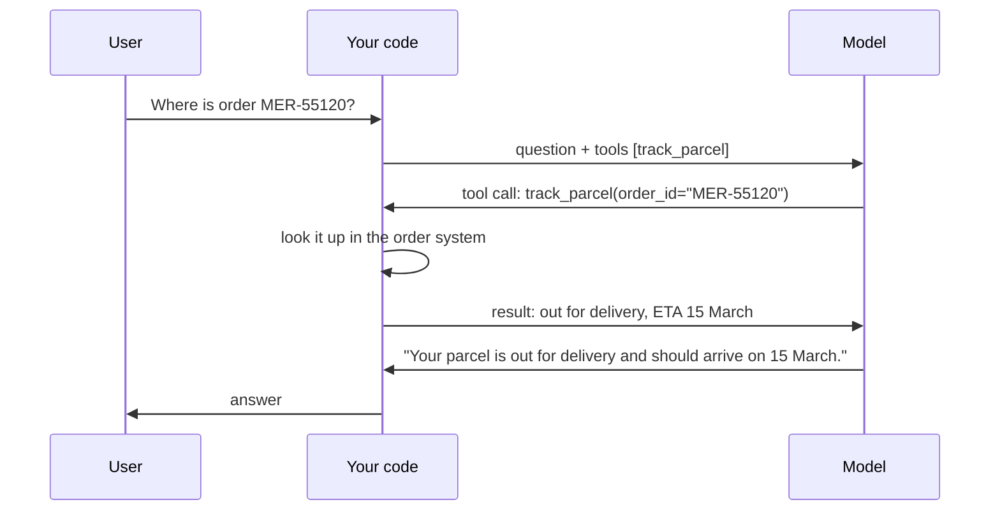

A model can only produce text. It can't look up a parcel, check a calendar or read today's weather. **Tool calling** (also called function calling) lets it *ask your code* to do those things.

## How it works

1. You send the question **plus a list of tools** your code can run, each described by a name, a description and the parameters it takes.
2. The model decides whether a tool would help. If so, instead of answering it replies with a **tool call**: a tool name and arguments as JSON.
3. **Your code** runs the tool - a database query, an API call, anything - and sends the result back.
4. The model reads the result and writes the final answer.

## The model never runs anything

This is the most important point to explain to customers' security teams. The model only **proposes** a call. Your code decides whether to run it, with which permissions, and what to return. That's where you enforce rules: read-only access, the user's own data only, confirmation before anything changes.

## Why FDEs use it constantly

Most customer value sits in their systems: order databases, CRMs, ticketing tools, internal APIs. Tool calling is how an assistant reaches live data instead of guessing - and how it acts: creating a ticket, booking a slot, updating an address.

| Without tools | With tools |
|---|---|
| "I can't check order status, please contact support." | "Order MER-55120 is out for delivery, arriving 15 March." |
| Hallucinated status | Real status from the system of record |
