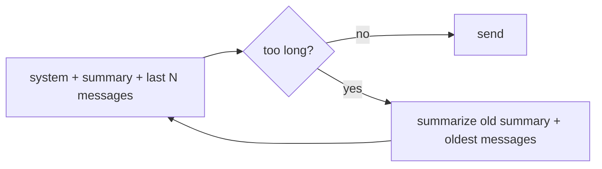

History can't grow forever. Each turn re-sends everything, so cost climbs, latency climbs, and eventually the request exceeds the context window. You need a policy for what to drop.

## Option 1: keep the last N messages

```python
system, rest = messages[0], messages[1:]
messages = [system] + rest[-MAX_MESSAGES:]
```

Simple and predictable. The cost: anything older is **forgotten**. If the customer gave their order number in turn one, it's gone by turn ten.

## Option 2: summarize what you drop

Before dropping old messages, ask a cheap model to compress them:

```text
Summary of earlier conversation: Tom from Harbor Foods reported that pallet MER-60311 is late. He asked for a callback before Friday.
```

Insert that as a system message right after the main system prompt. The model keeps the important facts at a fraction of the tokens.

When you trim again later, summarize the **old summary plus the newly dropped messages** together - otherwise each new summary forgets what the previous one held.



## Option 3: pull facts out explicitly

For structured facts - order id, customer name, account tier - extract them into fields and include them in the system prompt every time. More work, but nothing important depends on a summary's wording.

## Make the policy testable

Write the trimming as a function that takes the summarizer as an argument:

```python
def trim_history(history, max_messages, summarize):
    ...
```

Then a test can pass a fake `summarize` and check exactly which messages were dropped and what was kept - no model needed. You did the same with `ask` in the structured-output topic.
