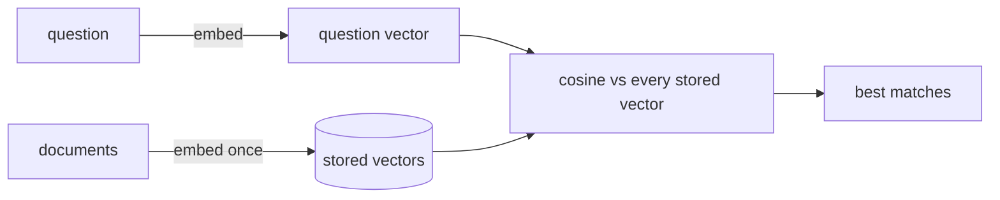

Once texts are vectors, "find the document that answers this question" becomes arithmetic:

1. **Embed every document once**, ahead of time, and store the vectors.
2. When a question arrives, **embed the question** with the same model.
3. **Score** the question against every stored vector with cosine similarity.
4. **Return the highest scores** - the most similar documents.

This is **semantic search**, and it's the "R" in RAG. It beats keyword search when customers use different words from the documents - "broken" vs "damaged", "tax" vs "import duties".

## The cost profile

- Embedding the documents is a **one-time** cost (plus updates when they change).
- Each question costs **one** small embedding call plus some arithmetic.
- Comparing against 10 documents or 10,000 is fast in plain Python; beyond about 100,000 you'll want a vector database (next topic).

## It finds similar, not correct

The top result is the most *similar* text - which is usually, but not always, the one that answers the question. A question about "pallet weight limits" may score high against a pallet article that doesn't mention weight at all. You'll see the failure modes, and fixes like hybrid search and reranking, in the retrieval-quality topic.

In the task you'll do the whole loop by hand over ten sentences.
