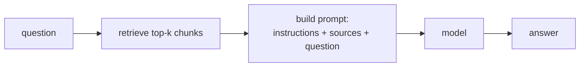

**Retrieval-augmented generation (RAG)** combines the two things you've built: search finds the relevant documents, and the model answers using them.



## Why RAG is the FDE's default tool

The model doesn't know the customer's documents (they weren't in training), and it can't learn them through use (inference doesn't change weights). RAG puts the right facts **in the prompt** at question time:

- **Current**: update the documents and answers change immediately - no retraining.
- **Private**: documents stay in the customer's store; only the few relevant chunks are sent per request.
- **Checkable**: you know which sources each answer used, so you can show citations.
- **Cheap**: a few chunks per request instead of the whole manual.

## The prompt

```text
system: Answer the question using only the sources below. If the sources don't contain the answer, reply exactly: I don't know.

Sources:
[a3] International shipping and customs. International parcels outside the EU need...
[a1] Reporting a damaged parcel. Report damage within 7 days...
[a5] Tracking a parcel. Enter the order id...

user: How long do customs checks take?
```

Three details matter:

1. **"Only the sources"** - steers the model away from its own (possibly wrong) knowledge.
2. **An exact "I don't know"** - a permitted, detectable way out when retrieval failed.
3. **Ids on each source** - so you can log, cite and debug which chunk was used.

## Minimal is enough to start

A first RAG system is about 40 lines: embed, rank, format sources, call the model. Frameworks add conveniences, but at a customer the minimal version is easier to debug and explain. You'll build it next.
