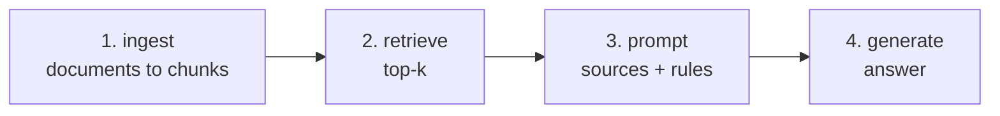

A RAG answer passes through four stages, and each fails differently. When a customer shows you a bad answer, your first job is to find **which stage** broke.

| Stage | Typical failure | Symptom | How to check |
|---|---|---|---|
| Ingest | Text lost in PDF conversion, empty pages, a table flattened into noise | The fact exists in the document but not in any chunk | Search the chunks for the fact's keywords |
| Retrieve | Right chunk ranked below k; vocabulary mismatch | Fact is in a chunk, but not among the sources sent | Run search on its own, look at the ranks |
| Prompt | Sources truncated, instructions unclear, too many distractors | Right source sent, answer ignores it or mixes sources | Read the exact prompt that was sent |
| Generate | The model misreads or adds outside knowledge | Right source, clear prompt, wrong answer | Re-run with a stronger model or a simpler question |

## The debugging order

Work **left to right**. It's tempting to tweak the prompt first because it's easiest to change - but if the right chunk was never retrieved, no prompt will help, and if the fact was lost at ingest, no retrieval will find it.

## Log enough to diagnose

For every request, log the question, the retrieved ids and scores, the prompt version and the answer. With that, most bad answers can be diagnosed in a minute from the logs, without reproducing anything. You'll set this up properly in the observability topic.

## A graceful failure is a success

When retrieval fails, the best outcome is a clear "I don't know" - not a confident invention. The next task breaks retrieval on purpose to show both behaviours.
