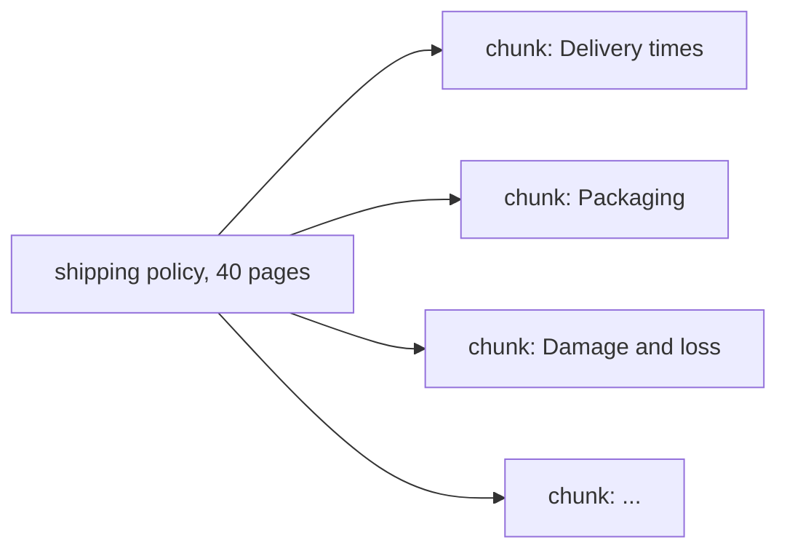

Customer documents are long: a 40-page shipping policy, a 300-page operations manual. You can't embed a whole manual as one vector - and you wouldn't want to.

## One vector per document doesn't work

- **The meaning gets averaged away.** One vector for 40 pages about everything matches every question a little and none of them well.
- **Embedding models have input limits**, often 512 tokens for small models like `lab-embed`. Text beyond the limit is silently ignored.
- **You'd send the whole document as context** for every question - expensive, slow, and the answer gets buried.

## So you cut documents into chunks

A **chunk** is a piece small enough to be about one thing - a section, a few paragraphs, a table - and large enough to make sense alone. Each chunk gets its own embedding and its own id. Retrieval then returns the three or four chunks that matter, not three or four whole documents.



## Cut along the document's own structure

The best boundaries are the ones the author already made: **headings and sections**. A section titled "Damage and loss" is about damage and loss. Cutting every 500 characters instead can split a rule in half - "Compensation is limited to" in one chunk, "25 EUR per kilogram" in the next.

## Give every chunk its context

A chunk that says "This must be reported within 7 days" is useless alone - *what* must be reported? Prepend the document title and section heading:

```text
Meridian Logistics Shipping Policy - Damage and loss
Damage must be reported within 7 days of delivery with photos...
```

That one line improves retrieval (the heading words are in the vector) and answers (the model knows where the text came from).

## Stable ids

Give chunks ids built from the source and section - `shipping-policy#damage-and-loss` - so citations are readable and re-indexing an updated document replaces the right chunks.
