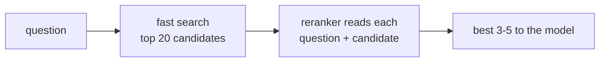

Vector and hybrid search are fast because they compare precomputed vectors and tokens. They're also shallow: they never actually *read* the question against the document. **Reranking** adds a second, smarter pass over a few candidates.



## Two kinds of reranker

| Reranker | How | Trade-off |
|---|---|---|
| **Cross-encoder model** (e.g. Cohere Rerank, BGE reranker) | A small model scores each question-document pair | Fast and cheap, purpose-built |
| **LLM as reranker** | Ask a chat model to order the candidates | Flexible, no extra service; slower and costs tokens |

Your lab has no dedicated reranker, so you'll use the LLM approach. The idea is identical.

## Prompting an LLM to rerank

```text
system: Rank the candidate articles by how well they answer the question.
        Reply with JSON: {"ranking": ["id", ...]} using only the candidate ids, most relevant first.
user:   Question: What happens if nobody is home for the delivery?
        Candidates:
        [a9] Missed delivery. If nobody is home, the driver leaves a card...
        [a2] Changing a delivery address. ...
```

## Never trust the ranking blindly

The model may drop ids, repeat them, or invent ones that weren't candidates. Merge defensively:

```python
def merge_ranking(candidates, ranking):
    seen, out = set(), []
    for i in ranking:
        if i in candidates and i not in seen:
            out.append(i)
            seen.add(i)
    return out + [c for c in candidates if c not in seen]
```

Valid ids come first in the model's order; anything it skipped keeps its original order at the end. The result is always a reordering of the real candidates.

## When it's worth it

Reranking helps most when the right document is *in* the candidates but not at the top - common with long documents and similar-looking articles. Measure: if the hit rate at k=3 improves on your test set, keep it. If not, it's just added latency and cost.
