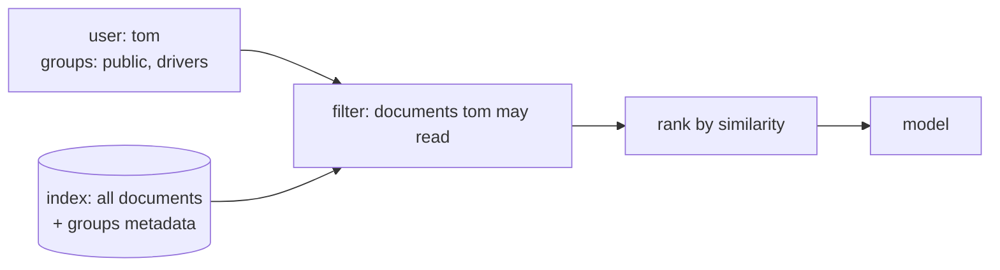

The fix: **every document carries its access metadata, and every search filters by the asking user's permissions before ranking.**



## In code

```python
def search(user, query, k=3):
    groups = set(USERS.get(user, []))           # unknown user -> no groups -> nothing
    visible = [d for d in DOCS if groups & set(d["groups"])]
    return ranked(query, visible)[:k]
```

Filter **before** ranking. Ranking everything and filtering the top-k afterwards returns fewer than k results - sometimes none - when the top hits are forbidden.

## In a vector database

Vector databases do this with metadata filters, applied inside the search:

```python
collection.query(query_embeddings=[q], n_results=3, where={"group": {"$in": ["public", "drivers"]}})
```

## Where permissions come from

- **Copy the source system's ACLs at ingestion** - each chunk gets the groups (or user ids) that can read its source document.
- **Resolve the user's groups at query time** from the customer's identity provider (Entra ID / Azure AD, Okta, LDAP) - not from anything the user typed.
- **Keep them in sync.** When someone leaves HR, their access must disappear from the assistant too - re-sync ACLs on a schedule, and treat stale permissions as a bug.

## Fail closed

- Unknown user -> no documents, not all documents.
- Document with no permission metadata -> not retrievable, until someone tags it.
- Identity service down -> refuse, don't fall back to "everything".

## Prove it, every release

Turn the leak into a test: for every user and a set of sensitive questions, assert that no result is outside their groups. It runs in seconds and catches the day someone "simplifies" the search code.
