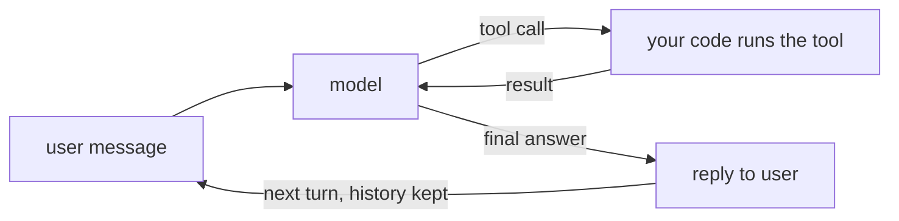

"Agent" is one of the most overloaded words in AI. Strip away the marketing and the definition used by most engineers is short:

> An **agent** is a model running in a loop, choosing which tools to call, until it decides the task is done.

You've already built the core of one: the tool loop in topic 11. The model looks at the conversation, picks a tool, your code runs it, the result goes back, and the model decides what to do next. Add **conversation history** across user turns and **tools that act** (not just look things up), and you have a working support agent.

## What makes it an agent rather than a script

| A script | An agent |
|---|---|
| Your code decides the steps | The model decides the steps |
| Fixed order: always look up, then answer | Calls zero, one or several tools as needed |
| Easy to predict and test | More flexible, harder to predict |

## Tools that act

Lookup tools are safe: the worst case is a wrong answer. **Action tools** - create a ticket, change an address, issue a refund - change the customer's systems. They need more care:

- **Narrow parameters** - `priority` as an enum, not free text.
- **Limits in code** - a refund tool that refuses amounts above a threshold, whatever the model asks.
- **Confirmation** for anything irreversible - the agent proposes, a human approves.
- **Audit log** - every action, with its arguments and the conversation that led to it.

## History includes tool calls

In a multi-turn agent the tool calls and results are part of the history. When the user says "open a ticket for **it**", the model knows what "it" is because the earlier `track_parcel` call and its result are still in the messages list.

In the task you'll combine the chat loop from topic 12 with the tool loop from topic 11.
