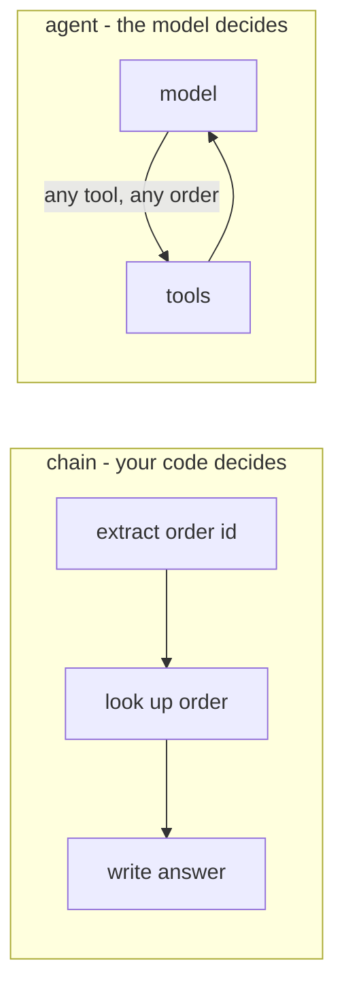

Agents are fashionable, so customers ask for them. Often what they need is a **chain**: fixed steps that your code runs in order.

## Compare them honestly

| | Chain | Agent |
|---|---|---|
| Predictability | Same steps every time | Steps vary per request |
| Cost and latency | Known: N calls | Variable: 1 to many calls |
| Testing | Test each step | Test outcomes across many runs |
| Failure modes | A step fails | Wrong tool, loops, giving up early, doing too much |
| Debugging | Read the code | Read traces |
| Best for | Known, repeatable workflows | Open-ended tasks where the path depends on what's found |

## Rule of thumb

**Use the simplest thing that works.** Start with a single model call. If that isn't enough, write a chain. Move to an agent only when the steps genuinely can't be known in advance - for example, an operations assistant that might need to check tracking, then depot hours, then a carrier API, depending on what each answer says.

"Where is my order?" always means: get the order id, look it up, answer. That's a chain - or even one call with one tool. Wrapping it in an autonomous agent adds cost, latency and new ways to fail, with no benefit.

## Hybrids are common

Many production systems are chains with **one agentic step**: a fixed pipeline that retrieves documents and validates output, with a small tool loop in the middle. You get flexibility where it's needed and predictability everywhere else.
