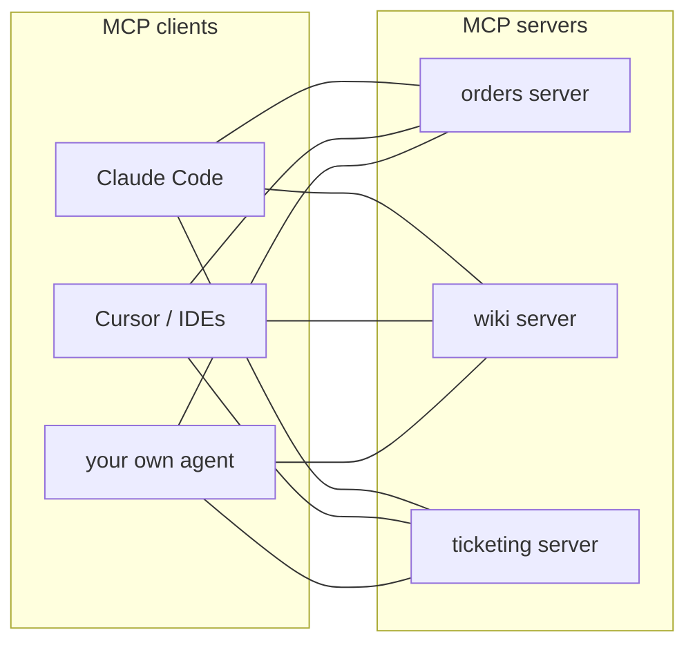

Every assistant you've built so far defines its tools **inside its own code**: a JSON schema, a Python function, a dispatch table. That works for one app. It breaks down when a customer has ten AI tools - a chat assistant, Claude Code for developers, an IDE plugin, an internal agent - and each needs access to the same order system, wiki and ticketing tool.

Without a standard, every pair needs its own integration: ten apps times five systems is fifty connectors, each written and secured differently.

## The Model Context Protocol

The **Model Context Protocol (MCP)** is an open standard, started by Anthropic and now supported across the industry, for connecting AI applications to tools and data. Write the integration **once** as an MCP server; any MCP-capable client can use it.

It's often compared to USB: one plug shape, many devices.

## Why FDEs care

- **Reuse across engagements.** An MCP server for a common system (Jira, Salesforce, PostgreSQL) works with whatever AI client the next customer uses. Many are already published.
- **One place for access control.** The server decides what the AI can see and do, with the customer's credentials - one component for the security team to review, instead of tool code scattered across apps.
- **Customers' own clients.** Developers using Claude Code or an IDE can query the order system through the same server your support bot uses.

## What MCP is not

It doesn't make tools safe on its own. An MCP server with a `delete_order` tool is exactly as dangerous as a Python function with that name. The same rules apply: narrow tools, read-only where possible, limits in code, audit logs - and only install servers you trust, because a server runs code on your machine.
