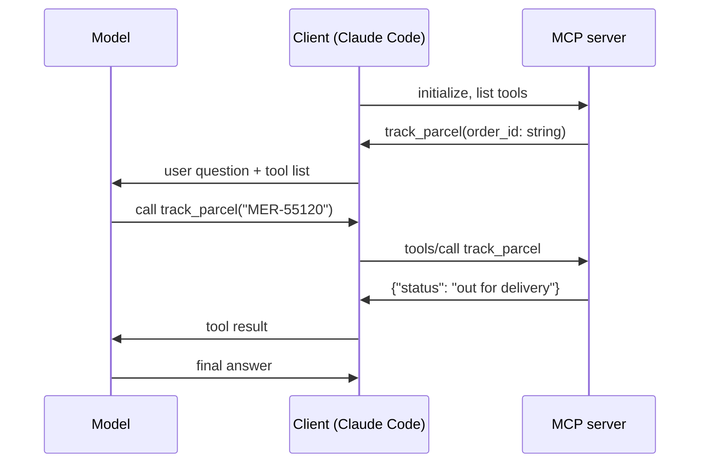

MCP has a few moving parts. You need just these:

| Part | Role | Example |
|---|---|---|
| **Host / client** | The AI application. Connects to servers, shows their tools to the model, runs the calls the model asks for | Claude Code, Cursor, your agent |
| **Server** | A program exposing capabilities | `meridian` server with `track_parcel` |
| **Tools** | Functions the model can call | `track_parcel(order_id)` |
| **Resources** | Read-only data the client can load | A policy document, a database schema |
| **Prompts** | Reusable prompt templates | "Summarise this ticket" |

Tools are by far the most used; this topic sticks to them.

## Transports

- **stdio** - the client starts the server as a child process and talks over standard input and output. Simple, local, no network. That's what you'll use.
- **Streamable HTTP** - the server runs as a web service; many clients connect over the network, with authentication. Used for shared, hosted servers.

## The flow



The tool loop is the same one you wrote in topic 11 - the client runs it for you, and the tool lives in a separate process.

## Writing a server in Python

The official `mcp` package includes **FastMCP**, which builds the tool schema from your function's type hints and docstring:

```python
from mcp.server.fastmcp import FastMCP

mcp = FastMCP("meridian")

@mcp.tool()
def track_parcel(order_id: str) -> dict:
    """Look up the delivery status of a Meridian order by its order id (like MER-12345)."""
    ...

if __name__ == "__main__":
    mcp.run()          # stdio by default
```

The docstring becomes the tool description - write it as carefully as any tool description. The type hints become the JSON schema.

Never `print()` from a stdio server: standard output **is** the protocol channel, and stray text corrupts it. Log to a file or to stderr.
