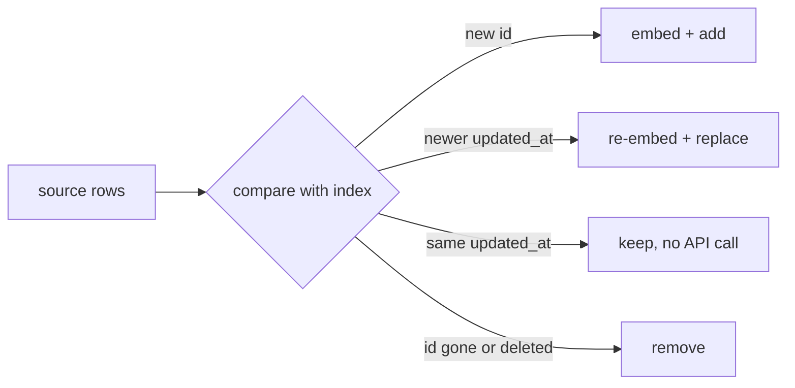

There are two ways to get data into your index, and most engagements use both - in that order.

## One-time export

The customer gives you a dump: a CSV, a folder of PDFs, a database backup. You clean it, chunk it and index it.

- **Fast to start** - no integration work, no production access.
- **Perfect for discovery and early pilot** - you can measure quality before anyone builds a pipeline.
- **Goes stale immediately.** The day after the export, a policy changes and the assistant is wrong.

## Continuous sync

A scheduled job (or event stream) reads changes from the source and updates the index.

- **Required for production** - answers must reflect current documents.
- **Needs real integration**: credentials, a read replica or API, monitoring, error handling.
- **Must handle all three changes**: new records, **updated** records, and **deleted** records. Forgetting deletes is the classic bug: a withdrawn policy stays retrievable forever.

## Incremental, not full

Re-embedding everything on every run is simple but wasteful - and with a large corpus, slow and costly. Incremental sync:

It depends on two things the source must provide: a **stable id** per record and a **change marker** such as `updated_at` or a version number. Ask for them in discovery.

## Common source traps

- **Soft deletes**: rows aren't removed, they get `deleted = 1` or `status = archived`. Filter on them.
- **Duplicates in exports**: the same id twice with different timestamps - keep the latest.
- **Drafts**: unpublished content must not be retrievable.
- **CSV quirks**: commas and newlines inside quoted fields - always use a CSV parser, never `split(",")`.
