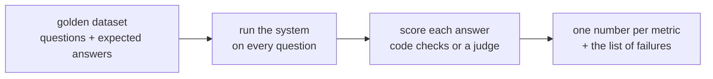

Every AI project reaches the same moment. Someone tries a few questions, the answers look great, and the room relaxes: "It works." Then the system meets a few thousand real users and the complaints start.

"It feels good" fails for predictable reasons:

| Why the demo misleads | What happens in production |
|---|---|
| **Tiny sample** - five questions you picked | Thousands of questions nobody picked |
| **Friendly questions** - you know what the docs cover | Users ask about things the docs don't cover |
| **No baseline** - nothing to compare against | You can't tell if a prompt change made things better or worse |
| **Memory bias** - the one great answer sticks | The 1 in 20 wrong answer is the one that gets escalated |
| **Non-determinism** - it worked once | The same question can get a different answer tomorrow |

## What an eval is

An **eval** is a repeatable test of the whole system on a fixed set of questions, scored the same way every time:

Three properties make it useful:

1. **Fixed questions** - the same set every run, so scores are comparable.
2. **Fixed scoring** - the same rules or rubric, so "better" means something.
3. **Failures you can read** - not just "82%", but *which* 18% failed and why.

## What it buys you

- **Confidence to change things.** Swap the model, rewrite the prompt, re-chunk the docs - and see in minutes whether anything broke.
- **An honest conversation with the customer.** "It answers 91% of policy questions correctly and refuses 100% of the out-of-scope ones" is a claim you can defend.
- **A list of what to fix next.** The failures are your backlog.

The next four topics build this up: golden datasets (26), model judges (27), regression testing (28) and RAG-specific metrics (29).
