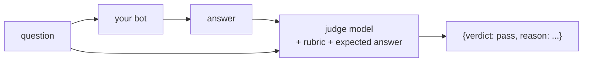

Some checks are easy in code: "the answer contains `7 days`", "the reply is the exact refusal", "every citation is a real id". Many aren't. "Customs checks usually add between two and five working days" is right; so is "expect 2-5 extra days for customs". String matching can't grade that reliably. A person can - and so can a model.

## LLM as judge

An **LLM judge** is a second model call that grades the first model's answer against a rubric:

## Design rules for a judge

| Rule | Why |
|---|---|
| **Give it the expected answer** | "Is this correct?" alone makes the judge use its own knowledge - which may be wrong about the customer's policy |
| **Binary verdicts: pass / fail** | 1-10 scores drift and cluster around 7; pass/fail with a reason is consistent and easy to act on |
| **Ask for a reason** | You'll read the reasons when the judge and a human disagree |
| **Structured output** | JSON with a fixed `verdict` field - and reject anything else |
| **Temperature 0, a strong model** | Grading should be as repeatable as possible; judges are a good place to spend on a bigger model because they run on tens or hundreds of cases, not on every user request |
| **Keep the rubric in a file** | You will change it, and you'll want to version it like a prompt |

## What a judge is good at

Semantic equivalence ("2-5 days" vs "two to five days"), spotting a missing fact, spotting a contradicted number, checking a refusal is a refusal. It's **not** a source of truth about the customer's policy - that's what the expected answer is for.
