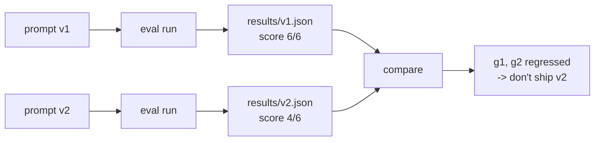

Prompts change constantly: a customer asks for a friendlier tone, legal wants a disclaimer, someone shortens it to save tokens. Each edit fixes one thing and can quietly break another. "Make it shorter" is a classic: the answers get crisper, and the fee or the second deadline silently disappears.

## Regression testing for prompts

The habit is the same as in normal software - **run the tests before and after every change**:

What makes it work:

- **Same golden set, same scoring** for both runs - only the prompt changes.
- **Results saved to files**, named after the prompt version, so you can compare any two runs later.
- **Case-level results**, not just the score. 5/6 -> 5/6 can hide one case fixed and another broken.
- **Cheap checks first.** "The answer contains `6 EUR`" is a code check: fast, free and exact. Use a judge (topic 27) only where code can't decide.

## Temperature 0 isn't determinism

Even at temperature 0, providers don't guarantee identical output. For a small suite, one run per version is a fine start. When scores wobble between identical runs, run each case two or three times and treat a case as passing only if it passes every time.

## Keep the loop fast

A suite that takes an hour won't be run. Keep a **smoke set** of 20-30 cases that runs in a minute on every change, and a full set for releases.
